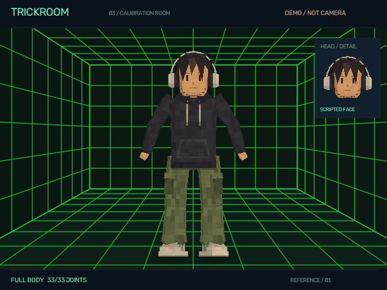

# TrickRoom

**Your movement. A new form.**

A local-first experiment in full-body, PS1-style VTubing, eventually inside a room with
interactable objects. The tracking prototype now wears the supplied **reference-driven character**:
dark spiky hair, beige headphones, charcoal hoodie, olive cargo pants and chunky sneakers.
It now stands in a **dark green wireframe calibration room** with a tiled floor, walls, ceiling and
subtle foot shadows. It remains a procedural test avatar, not a finished Blender rig.
The entire stage is synthetic; your camera image is never used as the background.

**Blender import is available:** load a prepared GLB humanoid through the studio's **Blender Model**
section. The [83-page authoring handbook](docs/TrickRoom-Blender-Authoring-Handbook.pdf) explains
the exact rig, shape-key, material, animation and export contract. See the
[model quick start](docs/12-blender-models.md) and [offline HTML guide](docs/book/index.html).

**Core motion upgrade:** native inference now runs in an owned child process. Imported GLB rigs
support world-space posing, bounded interpolation and optional labelled loss transitions.
Session-only facial calibration is available for both avatar paths. See the
[motion guide](docs/15-core-motion-upgrade.md); the built-in reference character is still procedural.

**Hip/hourglass correction:** imported limb frames now preserve their authored twist through
body turns. Restart an already-running TrickRoom instance to load this runtime fix; the same
GLB can be used without re-exporting or widening the model.



## Run it

Windows, Python 3.12 and an OpenGL 3.3-capable graphics driver:

```powershell
.\Setup-TrickRoom.ps1
.\Start-TrickRoom.ps1
```

Setup creates this repository's `.venv`, installs constrained dependencies, and verifies two
official MediaPipe model downloads. On this development machine setup has already been run.
Launch opens a clearly labelled demo without opening a camera, unless you explicitly supplied
`TRICKROOM_CAMERA_URL`. To force the no-camera demo, use `.\Start-TrickRoom.ps1 -Demo`.

In the connection panel, paste the **same IP Webcam app's HTTP/HTTPS `/video` URL**, add its
optional username/password, choose rotation, and click **Connect**. The source field is masked
and its address is not saved. Explicitly configured auth defaults are encrypted locally; field
edits are session-only. Use **Mirror output** to match your movements without reversing inference.
Open the **clean output window** for a separate synthetic view. Esc disconnects.

Every numbered control section can be expanded or collapsed by clicking its header. **Input**
starts open; the other sections start folded. **Expand all** and **Collapse all** stay at the
top of the panel. Folding a section preserves its settings and does not stop tracking.

To test without a live camera, click **Test from video...** under **Input** and select a
recording. Its detected movements drive the current synthetic avatar; **Replay last video**
starts it again after EOF or Disconnect. This is labelled **VIDEO REPLAY**, not scripted demo.
Recorded input also shows a **bottom playback timeline**: play/pause, click or drag to seek,
and elapsed/total time. With the slider focused, use Left/Right for one-second steps and
Home/End for the boundaries. These controls are Studio-only, never part of clean output.
Avatar and numeric-debug drawing run outside the UI thread so timeline dragging and controls
do not wait for a complete redraw. This improves interaction responsiveness, not tracking accuracy
or a guaranteed rendering frame rate.

## Render a model-review video without Studio

```powershell
.\.venv\Scripts\python.exe -m trickroom `
  --avatar 'C:\models\Character.glb' --source 'C:\references\movement.mp4' `
  --render-video '.local\review-v01.mp4' --snapshot '.local\review-v01-last.png'
```

This explicitly exports every reference frame to a synthetic MP4 plus an aggregate JSON report.
Add `--start-seconds 16 --seconds 3` for a short review. Existing outputs are protected; use new
names. See the [CLI model-review guide](docs/16-cli-video-rendering.md) for commands usable from
another chat/base, timing and codec details, and the distinction between a valid render and
subjective rigging/shape approval.

## What works now

- Full visible-body pose driving a clothed, depth-tested low-poly avatar and attached expressive head.
- Reference-style hair, headphones, hoodie details, cargo pockets and sneaker panels/laces.
- Optional segmentation contour and anatomical skeleton diagnostics; both start off.
- Enclosed perspective lab with a vivid green grid; toggle it off for a plain background.
- Independent blinks/winks, mouth opening, smile, brows, gaze and head pose.
- Original-resolution face crop for whole-body framing; enlarged head-detail view.
- Partial-body status when required joints are off-frame or low-confidence; stale tracking clears.
- IP Webcam MJPEG, explicit local camera devices, video replay, and bounded headless checks.
- Blender-exported GLB models: skinning, facial morphs, embedded textures, live retargeting,
  bind/clip previews, mapping profiles and transactional import diagnostics.
- Separate opt-in raw-input, black skeleton and black face-mesh debug windows; none enters clean output.

**Limits:** the built-in avatar is a landmark-posed assembly; imported GLBs can use the supported
humanoid skinning contract. Neither path reconstructs a human surface. Not every Blender/glTF
feature is supported, and single-camera pose estimates can be wrong, especially under occlusion.
Profile faces and distant facial detail can fail. Actual owner-camera qualification remains
open; synthetic demos and public-fixture results are not presented as that evidence.

**SDK network caveat:** inference runs locally, but the prebuilt MediaPipe SDK has usage telemetry.
Its maintainer states input data is not uploaded; this is not an independently verified
network-silence guarantee. See the [validation notes](docs/05-validation.md#native-sdk-telemetry-caveat).

[Engineering docs](docs/README.md) · [Camera guide](docs/01-camera-and-studio.md) ·
[Validation](docs/05-validation.md) · [TODO index](TODO/00_INDEX.todo) · [Journal](JOURNAL.md) ·
[Reference avatar](docs/10-reference-avatar.md) ·
[Perspective lab](docs/11-perspective-lab.md) ·
[Future Blender/rig direction](docs/07-blender-and-roadmap.md)
