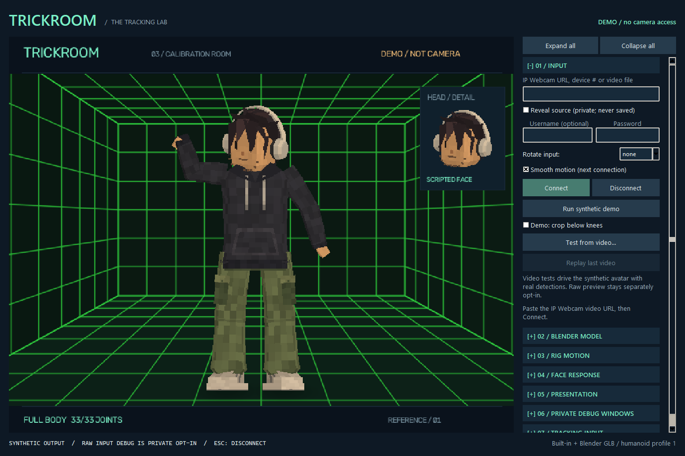
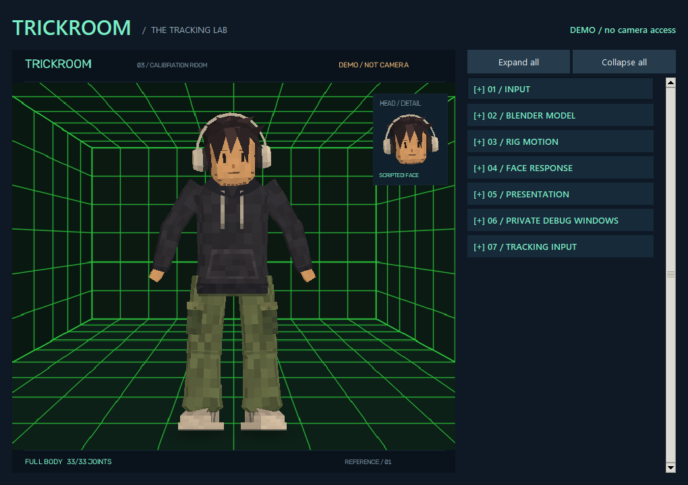
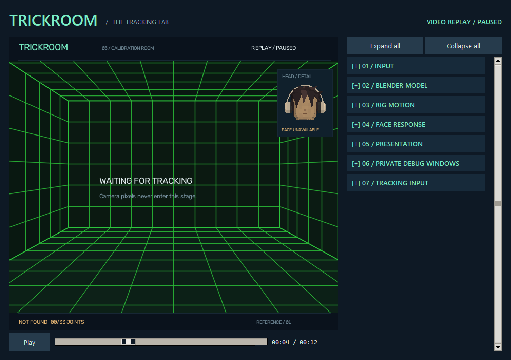

# 01 - Camera and studio guide



## Setup and launch

From the repository root:

```powershell
.\Setup-TrickRoom.ps1
.\Start-TrickRoom.ps1
```

Setup uses the installed Python 3.12 launcher, creates `.venv`, installs `.[dev]` constrained by
`requirements-lock.txt`, and downloads checksum-pinned Pose Lite and Face Landmarker models.
It neither opens a camera nor changes another project's environment.
Normal launch never downloads models. Missing or corrupt models produce a visible error.

The reference avatar also requires an OpenGL 3.3 graphics context. ModernGL/glcontext are included
in setup. The local AMD Radeon 780M context was verified; unavailable graphics support fails
explicitly rather than quietly reverting to a misleadingly broken 3D image.

If PowerShell execution policy blocks scripts, use the equivalent commands without changing
machine-wide policy:

```powershell
py -3.12 -m venv .venv
.\.venv\Scripts\python.exe -m pip install -c requirements-lock.txt -e ".[dev]"
.\.venv\Scripts\python.exe -m trickroom --download-models
.\.venv\Scripts\python.exe -m trickroom
```

## Connect IP Webcam

1. Start the **IP Webcam** server on the phone. Keep it reachable through the same tethering or
   local-network arrangement used for the prior project.
2. Paste its HTTP/HTTPS video endpoint into the source field. Example format only:
   `http://PHONE_ADDRESS:8080/video`. A bare server root is expanded to `/video`.
3. Enter username/password separately if the app requires authentication. Explicitly configured
   local defaults prefill these fields; the password stays masked. Stored defaults use Windows
   user-bound DPAPI encryption in ignored local storage, never hard-coded repository values.
4. Select `none`, `left`, `right` or `180` input rotation, then **Connect**.
5. **Mirror output** changes only presentation. Rotation is applied before inference; changing
   rotation or smoothing takes effect after disconnect/reconnect.

No address is guessed, no LAN discovery occurs, no old credentials are recovered, and the
tool does not alter the phone app's settings. This implementation accepts MJPEG over HTTP/HTTPS,
not RTSP. It supports Basic and Digest challenges, rejects cross-origin redirects, disables
environment HTTP proxies for the explicitly configured camera request, and retains normal
HTTPS certificate verification.

HTTP is not encrypted. Use a trusted local/tethered network; do not expose the phone camera
server publicly. Authentication does not add encryption to HTTP.

## Framing

Start with the entire body and some margin around the head, arms and feet. A stable phone and
adequate lighting matter more than a larger preview window. At long distances the face contains
fewer actual pixels; the pose-guided crop improves detector framing but cannot recover detail
the camera never captured.

If the lower legs are cut off, visible joints continue moving. The status becomes **PARTIAL
BODY** when major joints fail the confidence/in-frame checks. The prototype does not extend
legs below the frame or label an old observation as current tracking.

The stage preserves the input aspect ratio. A portrait input therefore has side margins in a
landscape window instead of a stretched body. There is no automatic person zoom or crop that
would hide entry/exit motion.

## Studio controls

All eight numbered sections are independently collapsible. Click a `[-]` or `[+]` header to
fold or open its controls, or focus the header with Tab and press Space/Enter. **Input** starts
open and the other sections start folded; **Expand all** and **Collapse all** remain above
the scroll area. Collapse all also returns the panel to the top.

Folding changes layout only: values, loaded models, calibration and active replay/camera sessions
remain intact. It does **not** disable an enabled private debug option or close its separate
window. Use the actual checkbox, window close button or Disconnect/Esc for those actions.
Expansion choices last for the current studio session and are not written to settings.



## 08 / Ghost camera

Tick **Fly the view** to move the viewpoint independently of the capture camera. The performer's
pose is unaffected by where you fly; this only changes where that pose is watched from.

| Control | Action |
| --- | --- |
| Click the stage | Capture the mouse for looking; the cursor hides |
| Mouse | Look. Yaw turns without limit; pitch stops just short of straight up or down |
| `W` `A` `S` `D` | Move forward, left, back, right along the view |
| `Q` / `E`, or `Ctrl` / `Space` | Descend and rise. Always world vertical, never view relative |
| `Shift` | Precision. Halves speed; it is not a sprint |
| `Esc` | Release the mouse. A second press disconnects as usual |
| Field of view | 20 to 120 degrees. Narrow flattens, wide exaggerates depth |
| Speed | 0.5 to 8 metres per second |
| Reset view | Return to the starting pose and stop |

The readout shows position, yaw, pitch, field of view and whether the mouse is captured.

Two limits worth knowing before you use it. It applies to **imported GLB models only**: the
built-in character is posed from image-space landmarks and has no real depth to view from another
angle. And the viewpoint cannot improve a single-camera pose estimate, so steep angles expose
depth error that a front view hides. See [ghost camera](17-ghost-camera.md).

The **Private Debug Windows** section has separate default-off options for raw input,
skeleton on black and connected face landmarks on black. Raw input exposes the real feed in
its own ordinary window; it never enters the avatar/clean image buffer. All debug views use
unmirrored input coordinates. See [debug and privacy details](13-debug-views.md).

The **Blender Model** section can load a prepared GLB, an optional name-mapping profile,
and live/bind/exported-clip modes. It does not load `.blend` directly. Read
[the model guide](12-blender-models.md) before preparing an asset. The default reference
character remains available through **Use built-in**.

**Rig Motion** adds world/image coordinates, interpolation and limb constraints for imported
GLBs. Strict loss visibility is the default; **Relax lost limbs (not tracked)** opts into
labelled held/rest poses. **Face Response** provides explicit neutral/range calibration and
per-control gains, without saving personal values. See [the motion guide](15-core-motion-upgrade.md).

Imported avatar size follows the current recorded/camera framing automatically; it is no longer
locked to the first partial-body frame. **Recalibrate** clears scale/pose smoothing history rather
than requiring a Blender-side rescale. Different authored proportions can still produce different
head or limb sizes from the procedural built-in.

| Control | Behavior |
|---|---|
| Connect | Creates a new capture/inference session; demo mode ends |
| Disconnect / Esc | Stops capture and inference, returns to a synthetic waiting screen |
| Run synthetic demo | Scripted movement, no camera; clearly labelled |
| Demo: crop below knees | Only changes the scripted demonstration |
| Test from video... | Select a local recording to drive the current synthetic avatar with actual detections |
| Replay last video | Start the last selected recording again after EOF or Disconnect; session-only selection |
| Camera contour (debug) | Optional segmentation-derived boundary; off by default |
| Skeleton joints (debug) | Optional landmark links and joint dots; off by default |
| Large head detail | Magnifies the same head/expression for inspection |
| Perspective lab room | Toggles the enclosed tiled room and visual foot shadows; off is plain dark |
| Open clean output window | Separate synthetic view without controls or diagnostic HUD |

The panel scrolls when expanded sections need more space. **Tracking Input** shows
capture/inference rates, skipped input
frames, post-decode observation age, available landmarks and face/head state. Blink bars measure
**closure**, not openness. A lost face resets expression bars; a muted face with an unavailable
label is pose-only/unknown expression, not a tracked neutral face. The same reference hair/headphones remain present during pose-only
fallback; the face treatment is muted and does not invent expression input.

The clean window is suitable for ordinary window capture, but TrickRoom does not yet register
or produce a virtual camera. Do not capture the configuration panel when you need private setup
details excluded.

The lab uses one coherent perspective projection across floor, ceiling and walls. Foot shadows
are decorative cues for eligible rendered shoes, not measured floor contact. See
[perspective-room details](11-perspective-lab.md); physical room reconstruction and interactions
are not implemented.

## Recorded-video test view

Under **01 / Input**, choose **Test from video...**, then select the recording. Both the
built-in character and an imported GLB can use it. An imported model is switched from bind/clip
preview to `live` tracking mode; here `live` means driven by observations, not a live camera.
The studio, main stage, head detail and clean output explicitly identify **VIDEO REPLAY**.

### Bottom playback timeline

A transport bar appears directly below the Studio preview for recorded inputs only. It stays
outside the rendered image, so it never appears in clean output, live-camera mode or scripted demo.
Rendering runs on a dedicated graphics thread; dragging does not queue a redraw or seek for
every mouse movement. The thumb/time update immediately, and releasing still commits one seek.
Model size and open diagnostic windows can limit visual frame rate without blocking the controls.

| Control | Behavior |
|---|---|
| Play / Pause | Stop or resume recorded input; Play after EOF restarts the same recording |
| Click or drag the slider | Preview the time while dragging; release to seek once |
| Left / Right, with slider focused | Move one second; release the key to commit |
| Home / End, with slider focused | Select the first or last valid frame |
| Elapsed / total time | Show media position, independently of capture/inference timestamps |



Paused replay freezes the numeric pose/face sample and labels it **PAUSED**; it is not a live
detection. A paused seek decodes and infers the selected frame, then remains paused. Raw private
preview still expires after 600 ms; the explicitly labelled black skeleton/face views can retain
the paused numeric sample. Disconnect, errors and ordinary stale/live input still clear.

Seeking clears temporal pose, scale and expression-filter history, but preserves completed
session-only facial calibration and gains. Unfinished calibration is cancelled; resume playback
before starting a new calibration. Seeking during active replay keeps its owned process; seeking
after EOF starts a fresh worker for the same recording at the selected position.

Timing uses decoded frame index and reported FPS, not exact variable-frame-rate timestamps.
The selected time is rounded down to an available frame; End selects the final frame. A decoder
that cannot reach the requested frame reports an error. Missing usable duration disables seeking,
not ordinary playback/pause. The timeline is not an audio player, editor or frame-accuracy repair.

**Replay last video** becomes available when playback ends or after Disconnect finishes.
It starts a fresh tracking worker and resets source-specific motion/calibration as an ordinary
reconnection does. The path is held only for this session in the masked source field and replay
selection; it is not hard-coded, written to settings or bundled. No automatic loop is enabled.
Disconnect an active source before selecting or replaying another recording.

The synthetic output uses detected body/face movement from the video, not `Run synthetic demo`
or `Demo: crop below knees`. **Detected skeleton on black** and **Detected face mesh on black**
can be enabled under **Private Debug Windows**. Raw preview stays separate and default-off;
selecting a recording does not enable it, record video or save frames.

## Alternative inputs

Explicit local camera:

```powershell
.\Start-TrickRoom.ps1 -Source 0
```

Existing video replay:

```powershell
.\Start-TrickRoom.ps1 -Source "C:\your-folder\calibration.mp4"
```

Replay is paced by the reported source FPS, supports the Studio timeline, and stops at EOF.
A file with incorrect FPS metadata can therefore play at the wrong real-world speed; this is
not a recording-time repair feature.
DirectShow device opening/reading depends on the device driver and is not as strictly bounded
as HTTP socket timeouts.

`TRICKROOM_AVATAR` names a GLB to load when `--avatar` is not given, so a personal character can
be the default without its path entering source, documentation or saved settings. Its
`.trickroom.json` sidecar is picked up automatically when one sits beside it. An explicit
`--avatar` always wins, an unset or blank value means the built-in character, and a path that no
longer resolves is reported rather than silently ignored.

```powershell
$env:TRICKROOM_AVATAR = 'C:\path\to\Character.glb'   # this session
[Environment]::SetEnvironmentVariable('TRICKROOM_AVATAR', 'C:\path\to\Character.glb', 'User')
```

`TRICKROOM_MODELS` relocates the MediaPipe task files.

`TRICKROOM_CAMERA_URL`, `TRICKROOM_CAMERA_USER` and `TRICKROOM_CAMERA_PASSWORD` can supply
process-local configuration. Auth environment variables override encrypted local defaults.
UI edits override the prefilled fields for that session and are not automatically saved.
The UI is preferred to avoid credentials in shell history or process arguments. No source URL,
`.env` file or plaintext credential file is written automatically.
