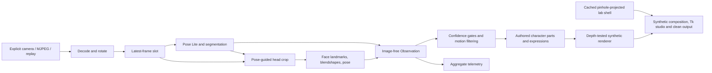
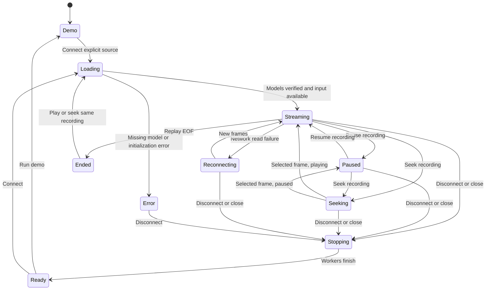

# 02 - Architecture and privacy boundary

## Data flow

`camera.py` owns pixels and source authentication. `tracking.py` temporarily consumes pixels.
The `Observation` crossing into rendering contains only numeric points, face controls,
polygon contours, dimensions and timing. **The avatar renderer and clean-output path never receive
the camera image.** The main/clean presentation converts only renderer-produced BGR images to `PhotoImage`.
The later explicitly requested private raw-input debug window is a separate opt-in path:
the runtime retains one read-only processed-input copy only while enabled, outside `Observation`.
It cannot enter the avatar renderer or clean output, and is cleared on disable/stop/staleness.

This makes privacy simpler than painting a mask over a live background. A missed face, a hole
in the contour, a cropped limb or a renderer placeholder cannot reveal camera pixels because
those pixels are never available to that part of the program.

This does not promise anonymity: body shape, gestures and expression-derived motion may still
be recognizable. Nor does it hide process existence or protect unrelated desktop capture.

## Execution domains and process ownership

### Capture thread inside the tracking child

HTTP MJPEG bytes are read with a three-second socket timeout, parsed into bounded JPEGs and
decoded. At most one latest decoded frame is retained. If several complete JPEGs arrive in
one read, only the most recent is used. The buffer is bounded to 8 MiB and accepted decoded
frames to 20 megapixels. Device and replay input use OpenCV.

Capture timestamps are assigned after decode/rotation. They are **not sensor timestamps**.
Frame age excludes earlier exposure, encoder, network and upstream buffering time.

### Inference child process

A single worker owns both MediaPipe tasks. It consumes the latest available frame, runs pose,
uses that frame's pose to select the face crop, runs face inference, normalizes the results and
publishes one immutable observation.

The worker is now a spawned child, not a native SDK thread inside the studio. A request/response
monitor in the parent retrieves bounded snapshots with at most one request outstanding.
Windows job ownership prevents the child outliving an abruptly closed studio. Startup, response
and shutdown timeouts become explicit errors; there is no automatic retry loop hiding a crash.
Only enabled private input debug transports an image, paired with its observation.

Both tasks use MediaPipe `VIDEO` mode with strictly increasing timestamps. The synchronous task
calls are deliberately placed off the UI thread. This is an alternative to two independent
asynchronous callback streams: it keeps the body and face temporally paired without callback
matching or hidden queues. If inference is slower than capture, old captured frames are dropped.
The count of skipped sequence numbers is exposed rather than pretending every frame was processed.

### Recorded-video transport

Only file sources accept play/pause and seek. The Studio enqueues coalesced commands; the parent
monitor remains the sole pipe owner. The capture thread remains the sole OpenCV decoder owner.
Paused capture waits on a condition variable and infers one selected frame after a seek. The
worker continues answering snapshots, so the normal response watchdog remains active.

Frames and observations carry separate media time and a seek generation. Capture/completion times
remain monotonic local timestamps. Every seek invalidates old observations/private previews,
rejects obsolete in-flight frames and recreates the native tracker inside its existing child.
Rig/scale/interpolation history resets; completed in-memory facial calibration survives, but
unfinished collection is cancelled. A seek never counts the jumped-over media frames as dropped
decoded frames.

Duration and position use reported frame count/FPS, not variable-frame-rate presentation timestamps.
Seeking checks the decoder's frame position and surfaces failures. EOF still releases the worker;
a later timeline seek restarts the same immutable file source, not the editable connection field.

### Offline reference-video export

`--render-video` uses a separate lockstep `RecordingReader`, not the live latest-frame slot.
An owned spawned child decodes/infers exactly one requested source frame; only its numeric
observation returns to the parent renderer/encoder. The next frame is requested after the previous
one is written, so slow rendering cannot silently drop reference frames.

This explicitly offline path uses frame index/reported FPS as the tracking and presentation clock.
Its numeric presentation copy uses source-relative completion time, and real-time interpolation
delay is zero. Actual inference/render processing durations are reported separately, never as
sensor latency. Studio/live timestamps and behavior are unchanged.

Outputs are staged, decoded again to check frame count/size/FPS, and published with exclusive
same-filesystem links. Inputs and existing outputs are protected; partial publication rolls back
only links still referring to this export's staged files. No input pixels/audio enter the output.
See [CLI export](16-cli-video-rendering.md) for the report and unsupported VFR/live-source cases.

### UI thread

The Tk control/transport loop runs on a 16 ms timer and never performs avatar rendering.
It submits at most one image job at a time, installs completed images on the UI thread and yields
between view updates. Targets remain 60 Hz for enhanced imported rigs, 30 Hz otherwise and 15 Hz
for diagnostics; they are scheduling targets, not achieved frame-rate guarantees.

The independent control loop also revokes already displayed images after seek/source changes,
errors or the normal stale deadline, even when a graphics job is still running. Completed jobs
must match the current source, seek generation and presentation epoch. A slow obsolete draw
cannot restore an old pose after a seek. Explicit paused numeric inspection remains distinct.

Imported rigs can interpolate numeric presentation poses between observations. Optional local
loss handover is labelled held/returning/rest, not counted as tracking. Source-stale clearing and
raw-diagnostic eligibility do not change. See [core motion](15-core-motion-upgrade.md).

The clean output uses the same renderer and current observation stream with its HUD disabled.
Views can update at different instants; a paused sample renders consistently across them. No virtual
camera, browser server, audio service or cloud inference process is created.

The static lab backdrop uses a pinhole projection of five authored surfaces, not a real camera
background. It has a bounded read-only cache by stage size. Character shoe bounds optionally
supply decorative, floor-clipped shadows before the depth-rendered avatar is composited.
These are presentation operations, not an update to the inference, world calibration or physics.

### Graphics thread

`GraphicsWorker` is the single owner of mutable renderer state and its thread-local OpenGL
resources. Avatar drawing, numeric skeleton/face drawing and renderer-control operations are
serialized through a bounded queue. It publishes immutable status snapshots; exceptions return
through futures and cause explicit safe shutdown rather than leaving a success-shaped frozen view.
No Tk calls occur there. The separate opt-in raw-input window remains outside the avatar renderer.

Model parsing remains a separate worker operation. A validated import is committed by the graphics
owner before the UI marks it ready. Shutdown stops new work, cancels queued work and closes graphics
resources on their owning thread. A draw has a five-second response bound; shutdown retains an
explicit deadline/error. This thread is not a security sandbox or a repair for native driver faults.

Static dominant-bone roles use numeric lookup indices. Head-triangle and foot-vertex masks are
computed once per imported asset, read-only thereafter; changing poses still recomputes actual
eligibility. This avoids repeated string-array searches without altering the visibility contract.

### Reference-avatar graphics

Imported Blender GLBs take a separate validated asset path: `assets\gltf.py` loads the
bounded profile, `animation.py` applies morphs/skinning, `retarget.py` poses the hierarchy
and `presentation.py` places it on the same synthetic stage. The textured depth renderer
honors the supported materials/samplers. Import parsing runs in a worker and only a
fully validated asset replaces the current model. See the authoring handbook for the contract.

`avatar.py` constructs cached 3D part templates with deterministic, object-space color tiles.
Body segments are oriented between eligible landmark endpoints; the head uses the existing face
pose/expression contract. This is direct part posing, not skinning or inverse kinematics.
`raster.py` owns a thread-local OpenGL3.3 context and a bounded four-target framebuffer cache.
Flat-shaded triangles are depth-tested per pixel, then the synthetic alpha result is composited
over the synthetic stage. No reference image or camera frame is uploaded as a texture.

A painter-order trial was rejected because mean-triangle-depth sorting produced oblique-view
overlap artifacts. The depth buffer is a correctness requirement, not an optional visual effect.
Contexts, framebuffers and buffers are released on normal exit/interrupt; graphics initialization
failure also destroys the native window and reports an actionable error.

## Lifecycle

HTTP failures surface a redacted message and retry after one second. Runtime/model failures
stop inference and report an error. Unexpected worker termination is also surfaced in status;
it is not left as a success-shaped running state.

All shutdown paths signal capture and inference, close models, and release source resources.
Bounded headless checks report whether the child actually stopped and whether termination was
forced. The desktop's shutdown deadline remains explicit; the owner can terminate its specific
stuck worker without killing unrelated Python processes.

## Freshness

An observation older than 600 ms after local decode is not rendered as live body/face geometry.
The stage becomes a synthetic waiting/stale screen. There is no indefinite extrapolation.
When face inference fails but pose still detects the head, the body can continue with a muted
pose-derived head and unavailable expression state.

An explicit **PAUSED REPLAY** is a separate inspection state. Numeric presentation evaluates the
selected recorded sample at its completion time without rewriting its original timestamps or
fabricating new detections. The exception requires recorded media metadata and an explicit pause;
it does not apply to a live source, an error or a disconnected source. Raw input preview retains
its normal 600 ms expiry. Playback widgets belong only to Studio layout, never renderer buffers.

The previous project's raw-face protection and inferred-depth failures informed this boundary,
but no cardboard mesh, runtime package or sibling source checkout is required here.
