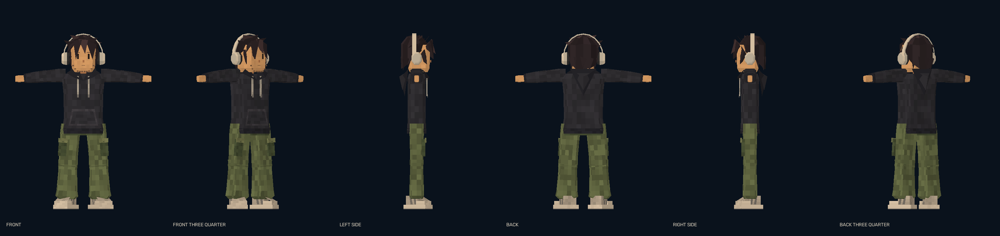
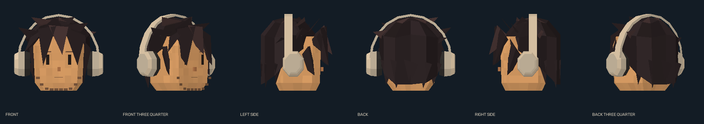
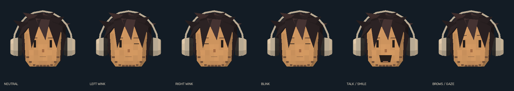

# 10 - Reference-driven avatar

## Supplied art direction

On 2026-10-11 the owner supplied two images and explicitly said the test model should be very
close to the intended final output. They are visual references, not mesh files, rigs or UV maps.
Both sheets were inspected in full:

| Reference | SHA256 |
|---|---|
| Low-Poly Character Asset Sheet.png | `3ece096171c404ba36eeaeb46ef3f6350e379db545f8b184b334c594dda41c5c` |
| Retro Low-Poly Character Turnaround Sheet.png | `77656fc911c7504e0eb060b393e26d49ec3fc21f35db41f31bb8bd4940f39ff8` |

Original files are unchanged. Private working copies are under `.local\references`; they are
not bundled or published. Their licensing/provenance beyond owner supply has not been established.
No model topology or printed triangle count on a reference sheet is claimed as verified geometry.

## Visual contract

- Oversized, warm tan, angular head with small dark vertical eyes and understated facial details.
- Jagged, layered, dark brown/near-black hair, including fringe and a complete back silhouette.
- Beige/taupe over-ear headphones with a faceted headband, polygonal cups and dark inner padding.
- Charcoal pullover hoodie: roomy sleeves, visible hood, V-shaped collar folds, light drawstrings,
  kangaroo pocket, ribbed cuffs and hem.
- Loose olive cargo pants: broad legs, mottled pixel-scale cloth, thigh pockets/flaps and gathered cuffs.
- Chunky cream/taupe low-top sneakers: substantial sole, stepped toe, laces and contrasting panels.
- Low-poly planar geometry, restrained flat lighting and stable, object-attached tonal texture.

The old mint/lilac mannequin is not the character's clothing palette. Those colors remain useful
only for optional anatomical-side diagnostics. The stage must not default to drawing them through
the reference-driven clothing.

## Boundaries

This update changes the procedural prototype's appearance and presentation, not the camera,
landmark model, normalized expressions or image-free output boundary. The final Blender authoring,
skinned rig, IK/retargeting and exact export contract remain separate future work.

Material details are authored from the visual reference; no image is pasted over the camera or
presented as recovered 3D geometry. Artistic resemblance is evaluated by rendered views, not by
unit-test counts. Owner visual approval remains unrecorded until feedback is provided.

## Delivered implementation

`src\trickroom\avatar.py` contains the authored/cached geometry, materials and part posing.
`src\trickroom\raster.py` supplies true per-pixel depth through OpenGL3.3. Mean-depth painter
sorting was rejected after visible pocket/hair overlaps appeared at oblique angles.

The model includes all six character categories above and keeps the original face/body
observations. The head is deliberately stylized larger than a human face bound; body part
lengths still follow the camera-derived endpoints. It is not an exact fixed-proportion rig.
The simple hands follow pose/wrist anchors, not detailed finger tracking.

Front, three-quarter, both sides and back were inspected, along with the animated pose, cropped
legs, face loss and stale state. Rear-view art inspection does not imply reliable rear-face
tracking. The generated `avatar-manifest.json` records the geometry count, graphics identity,
warm timing and image hashes; the actual count includes the colored material tiles.

90tests, eleven native UI groups and the actual-model/loopback checks passed. Current aggregate
evidence is `docs\evidence\prototype-validation.json`; the original mannequin receipt remains
`docs\evidence\m1-prototype-validation.json`. Owner visual approval and actual phone qualification
are still unrecorded. Workstream11 and JOURNAL.md retain the implementation history.
