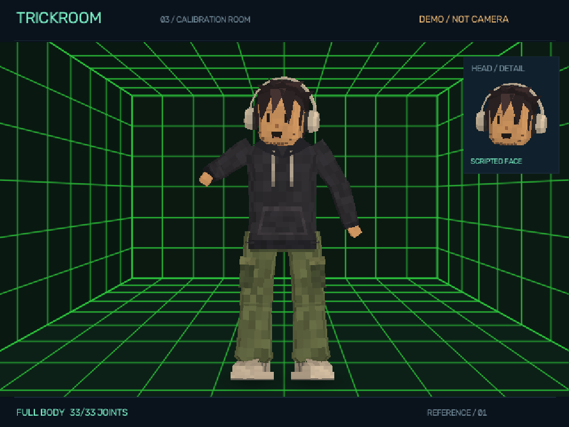
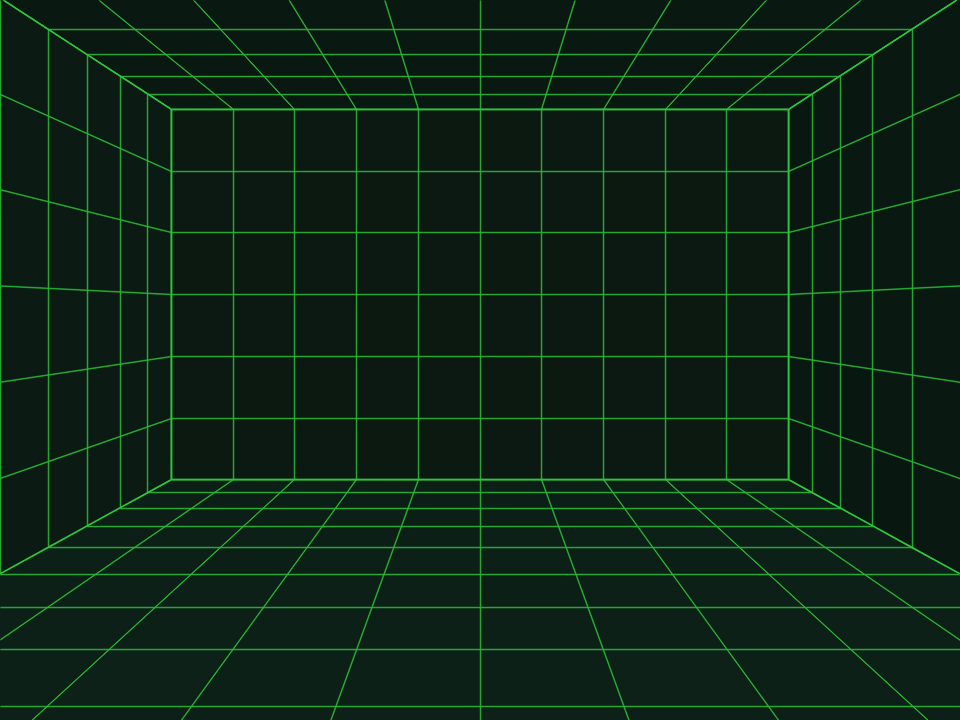
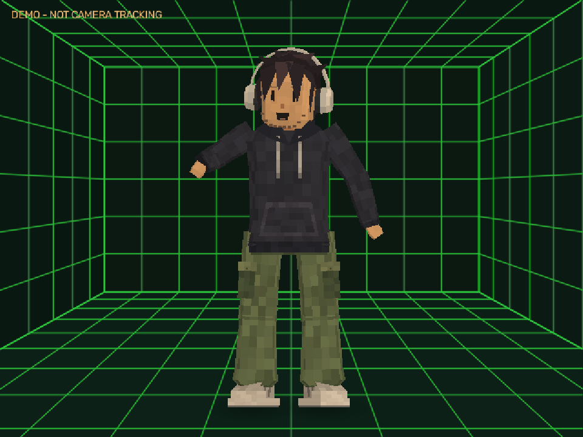

# 11 - Perspective calibration room

## Direction

The owner supplied a white-grid tunnel image and a grey calibration room with a mannequin
as an example of spatial presentation. The request was to make the existing character feel
inside a test lab with proper perspective, not to replace the reference character or implement
the later interactive-object system.

The subsequent theme reference switches the room to near-black green panels with thin vivid
green grid lines and green borders. The earlier calibration crosses are removed. This is a
palette/marking update; the projection, character, foot-shadow rules and controls are unchanged.

| Supplied image | SHA256 |
|---|---|
| copilot-image-4f6137.png | `650a061152786a5838e5cefa6ccf4584c3dfa15ce9f57ca5c9a09ff44f86fb36` |
| copilot-image-034535.png | `203349f64668558009b631545c8286764956db532c1c9320b38fbaedd0cfb734` |
| copilot-image-f214d3.png (current theme) | `654a45bf28717481b0271fe8c3b25e1d76c1b51cbdd4ac12fc9bdd5c7f90ac57` |

All supplied images were inspected. Private unchanged copies are retained in `.local\references\room`.
They are not pasted into the rendered background or published as project assets.



## Five projected surfaces

`room.py` defines a floor, ceiling, left wall, right wall and back wall in a small synthetic
coordinate system. A single pinhole camera projects every tile and edge:

```text
screen_x = center_x + focal * world_x / depth
screen_y = center_y - focal * (world_y - eye_height) / depth
```

The shell is six units wide, 3.6 high and extends from depth 0.6 to 8.4. Tile spacing is 0.6.
These are **authored scene units**, not measurements of the user's room or camera.
The focal length and principal point derive from the preview dimensions and HUD allocation.
Depth-parallel grid lines therefore meet at one vanishing point, and equal world-space tiles
shrink with distance. Walls/floor share exact corner coordinates rather than separate approximate
screen-space trapezoids.

Near-black green per-plane colors separate floor, walls and ceiling. Small deterministic tonal
variation keeps the surfaces quiet while vivid green lines define the volume. The current
theme intentionally has no calibration crosses.
The original PS1-style character geometry, pose, expressions and camera framing are unchanged.



## Cached rendering and aspect ratios

The projected room is static for a given width, height and HUD setting, so its image and floor
mask are cached. The cache retains at most four sizes. Cached arrays are read-only, and the
renderer copies the background before drawing the character or shadows.

Landscape, portrait, wide and clean-output views use the same projection equations. Very wide,
short previews naturally devote more area to side walls; a fixed floor-coverage percentage
would incorrectly distort the room. Tests check the projected floor area/corners instead.

The existing `StageOptions.grid` field is retained for compatibility but now toggles the entire
room. Its studio label is **Perspective lab room**. Off returns to the plain dark synthetic
background. The separate clean output uses the same toggle and omits the diagnostic HUD.

## Visual foot shadows, not floor tracking

The character builder can emit a `Footprint` from the bounds of each shoe it actually builds.
A shoe still requires eligible ankle and foot-index observations; collecting its footprint
does not change the geometry. Missing shoes cannot generate shadows.

For each footprint, a presentation ray is intersected with the decorative room floor. A small
soft ellipse is projected on that floor and drawn behind the character. The mask is clipped
to the floor and HUD bounds; overlapping shadows combine monotonically rather than erasing
one another. A point outside the visible floor produces no shadow.

This is a **visual grounding cue**. There is no measured ground contact, floor calibration,
room-scale reconstruction, foot locking, collision, jump-height estimate or light simulation.
A floating/raised foot that projects onto the decorative floor is not proof of contact.
Do not reuse this presentation heuristic as a future interaction/physics decision.

When tracking is stale the character/shadows clear together. The room remains visible.
No camera pixels, physical background or reference image pixels are used at any stage.

## Scope boundary

This implements the visual room requested now. `TODO\10_INTERACTIVE_ROOM.todo` still owns
future objects, contact logic and interactions, and remains NOT_STARTED.
The Blender rig/retargeting work is also separate. No example mannequin was imported.

## Review and checks

```powershell
.\.venv\Scripts\python.exe tools\render_room_gallery.py
.\.venv\Scripts\python.exe -m pytest tests\test_room.py
```

The gallery includes enclosed-room, empty, portrait, wide, clean, cropped, stale and room-off
views with hashes and camera parameters in `room-manifest.json`.
Checks cover shared vanishing point, inverse floor projection, foreshortening, explicit invalid
input, bounded/immutable caching, floor-only shadows, missing-foot behavior, unchanged character
geometry and exact presentation mirroring.



Actual-camera quality and owner visual acceptance remain separate from generated demonstration
images and mathematical/runtime checks.

## Delivered evidence

The green-theme revision passed 169 tests with no skips, including the two new palette/marking
checks and eight guarded UI-capture cases. Twelve native studio groups and nine imported-model
groups also passed. Landscape, portrait, empty, clean-output and both native model paths were
visually inspected. The warmed gallery sample measured 10.11/10.95 ms median/p95 full rendering;
this is not camera-to-display latency. The main previews, GIF, native screenshots and handbook
were refreshed. See workstream17 and the current aggregate receipt.

The original room milestone passed 107 tests and twelve native UI groups. The full public-fixture/
MJPEG pipeline was repeated with the room active, including body/face reacquisition and safe
cleanup. At that milestone's final loopback check, 116 frames reached body and face inference with
15.46 ms mean rendering time. A separate warmed gallery sample measured 11.03/12.25 ms
median/p95 full-render time on this machine. These are historical measurements, not a new
live-camera run for the palette update.

Landscape, portrait, wide, clean, empty, cropped, stale and room-off images were inspected.
The current aggregate receipt includes source hashes and all three visual manifests.
See `docs\evidence\prototype-validation.json` and workstream12 for the exact completion record.
The reference character remains unchanged; no example mannequin or interactive object was added.
