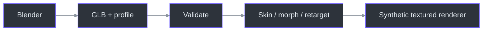
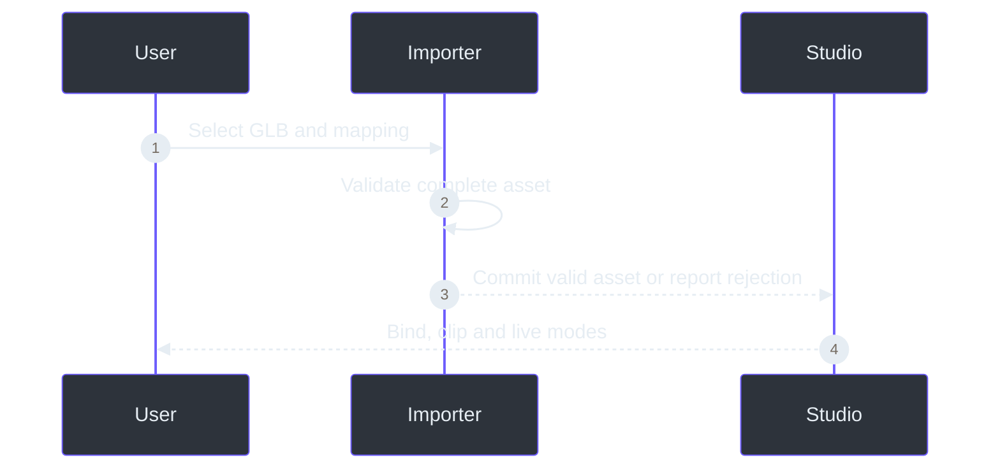

# Blender model support

TrickRoom now loads prepared **glTF 2.0 binary (`.glb`) humanoids exported from Blender**.
The built-in reference avatar remains available; importing the technical fixture is not a
replacement for the final character art.

**Read the full [Blender authoring handbook](TrickRoom-Blender-Authoring-Handbook.pdf)**:
83 A5 pages, 35 chapters/workshops, model/rig/material/shape/animation/export instructions,
source citations, diagrams and troubleshooting. An [offline HTML edition](book/index.html)
and [editable manuscript](book/AUTHORING.md) accompany it.

## Use it

```powershell
# Validate without opening a camera
.\.venv\Scripts\python.exe -m trickroom `
  --validate-avatar examples\blender\TrickRoom-Conformance.glb

# Imported model driven by the explicitly synthetic demo
.\Start-TrickRoom.ps1 -Demo `
  -Avatar examples\blender\TrickRoom-Conformance.glb
```

In the studio, use **Load Blender GLB**, optionally select a mapping profile, and inspect
**View model report**. Select `live`, `bind` or an exported clip. **Recalibrate** resets the
model's scale/pose smoothing history; display size follows the current detected framing rather
than locking to the first frame. **Use built-in** returns to the reference character.
Invalid imports retain the previous avatar with an explicit rejection message.

For an unattended model-authoring review, use `--render-video` with a GLB and reference recording.
It creates a synthetic MP4, aggregate JSON and optional last-frame PNG without opening Studio.
See [the CLI export/handoff guide](16-cli-video-rendering.md). A successful export is technical
evidence, not an automatic claim that the rig, body shape or deformation is artistically correct.

The **Rig Motion** section now enables world-space posing and display interpolation for imported
models. Missing-region visibility remains strict unless **Relax lost limbs (not tracked)** is
explicitly enabled. **Face Response** supports session-only neutral/range calibration and gains.
See [core motion controls and limits](15-core-motion-upgrade.md).


## Implemented contract

| Area | Supported |
|---|---|
| Container | Self-contained GLB2, embedded buffer and PNG/JPEG images |
| Skeleton | Required humanoid ancestry; canonical or explicitly mapped names |
| Skin | Linear blend skinning, inverse bind matrices, four influences |
| Face | Twelve default morph controls, or eight plus effectively bound eye bones |
| Materials | Base color/factor/vertex color, OPAQUE/MASK, sidedness, unlit/diffuse |
| Texture sampling | UV0, nearest/linear/mipmap, repeat/clamp/mirrored repeat |
| Animation | TRS and morph weights, LINEAR/STEP, bind/clip preview separate from live |
| Live movement | Fixed-length world/image rig posing, optional two-bone constraints, interpolation, face response |
| Loss behavior | Strict region visibility by default; opt-in labelled pose handover; stale geometry clears |

The detailed budget/naming/axis contract lives in the handbook and
`src\trickroom\assets\profile.py`. `.blend`, FBX/VRM, control-rig evaluation, IK foot locking,
full finger tracking, cloth/spring physics, PBR texture maps, transmission, compression and
arbitrary glTF extensions are not claimed. Bake supported results into the documented export.





## Actual interoperability evidence

The original technical fixtures were created/exported with Blender4.5.14 LTS.
Runtime deformation was compared with Blender-evaluated geometry: maximum observed vertex
errors were approximately2.25e-7 and5.90e-8 scene units for the wave and facial clips.
The alternate eye-bone fixture also moved its actually weighted eye vertices.
These are implementation/fixture results, not owner-camera or final-art approval.

The reusable scripts are `tools\blender\preflight.py`, `export_character.py`,
`create_conformance_rig.py` and `sample_conformance.py`. Numerical/runtime checks are in
`tools\verify_blender_models.py`; native import lifecycle checks are in `tools\check_model_studio.py`.

The handbook's source citations resolve directly to importer, profile, math, skinning,
retargeting, presentation, renderer, studio and export-helper implementations. See its chapter
references rather than treating this quick-start matrix as a substitute for the full contract.

Implementation references: `src/trickroom/assets/gltf.py:820` (`load_asset`),
`src/trickroom/assets/profile.py:99` (`RigProfile`),
`src/trickroom/assets/animation.py:63` (`deform`),
`src/trickroom/assets/retarget.py:134` (`retarget`), and
`src/trickroom/raster.py:109` (`DepthRenderer`).
