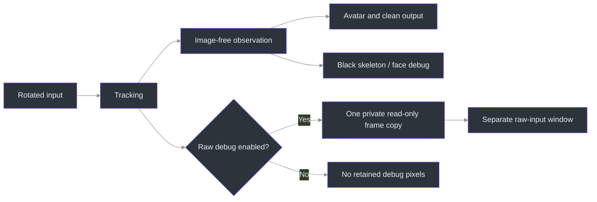
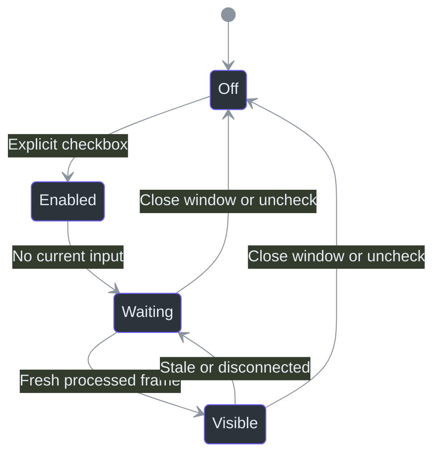

# Private debug views

The studio's **Private Debug Windows** section provides three independently controlled windows.
All start off on every launch; none is part of the avatar image or clean output.

| Option | What it shows |
|---|---|
| Raw input camera (private) | The actual rotated source frame paired with a completed inference result |
| Detected skeleton on black | Eligible pose points and their skeletal connections, without avatar/room/pixels |
| Detected face mesh on black | Detected facial points, tessellation, feature contours and iris connections |

## Orientation and freshness

The input is shown after the configured camera rotation and before model-specific downsampling/
face cropping. It is **unmirrored**, matching the coordinates used for inference. The black
tracking windows use that same input orientation; **Mirror output** affects the avatar, not these
diagnostics. The facial mesh is fitted for inspection using original image pixel proportions,
so portrait input does not squash the face.

Frame IDs identify the observation. Raw and numeric data are published together. A latest captured
frame can be ahead of this processed-input debug frame because inference intentionally skips
old capture frames. These are input diagnostics, not a sensor-to-display latency measurement.
The skeleton uses the same configured motion smoothing as the normal pose output; the facial
mesh uses the normalized detected landmark coordinates, not the avatar's mesh vertices.

The inference child sends raw frames only while enabled and at up to 15 Hz. Raw and numeric
debug views use the same paired snapshot when that preview is present. Face-connectivity data
is packaged statically, so these windows do not import the native SDK into the studio process.
Enhanced rig poses and calibrated facial response never replace the raw debug observations.

Old results clear after the existing600ms freshness boundary. Disconnect/stop clears the retained
raw frame immediately. Closing the raw window unchecks its option and disables retention.
If it remains checked through a reconnect, it resumes for the explicitly reconnected source.

Explicitly paused recorded input is the numeric-only exception: skeleton/face windows may retain
the selected sample, labelled **PAUSED REPLAY / unmirrored / no camera pixels**. Its timestamps
and detector counts do not advance. Raw preview still expires normally, even while paused.
Seeking discards old samples and their private preview before accepting the new generation.
This inspection mode never extends live-source freshness or survives a disconnect/error.

The scripted avatar demo is not a detection source: these windows wait for actual camera/replay
observations rather than inventing a detected face mesh from the avatar geometry.

## Privacy

Raw preview is deliberately unmasked. It can show your face, room and anyone else in frame.
Its window is an ordinary desktop window, **not capture-excluded**. A full-monitor recording
can capture it. Capture only the intended clean output and verify your capture application's
behavior; the application cannot guarantee every external screen-capture configuration.

Enabling a debug view does not start a camera, record video or save frames. There is no automatic
raw/landmark dump. Debug window rendering is capped at15updates/second to limit extra UI work.
The main output remains synthetic even when raw debug is open.
Black numeric views render on the graphics worker; Tk only installs their completed images.
They share the same seek-epoch and stale-result rejection as the avatar. Raw pixels remain on
their separately enabled debug path and are never submitted to the avatar renderer.

## Local authentication defaults

Requested defaults are stored only in `.local\camera-auth.dpapi`, encrypted for the current
Windows user. The actual values are not documented, logged, hard-coded or stored in context.
Cloning the repository does not copy this ignored local file.

The CLI prefills the normal masked password field from these defaults. Explicit environment
variables take precedence; editing the fields changes only that session. A corrupt or
undecryptable local record fails explicitly instead of silently substituting another credential.
The camera address is never guessed or bundled.

## Verification

Unit checks exercise DPAPI round-trip/non-plaintext storage, opt-in copies, atomic frame pairing,
stale clearing, black backgrounds, real connection indices and unchanged clean output.
`tools\check_debug_views.py` opens/closes all three windows with authored synthetic frames and
landmarks, verifies raw-disable/reopen/disconnect, and keeps the physical camera unopened.
Synthetic lifecycle evidence is not a claim of the owner's live feed being tested.

Implementation: `src/trickroom/debug_views.py:120` (`face_mesh`),
`src/trickroom/runtime.py:29` (`Runtime`), `src/trickroom/studio.py:27` (`Studio`),
`src/trickroom/credentials.py:89` (`load_defaults`) and `src/trickroom/cli.py:190` (`main`).
