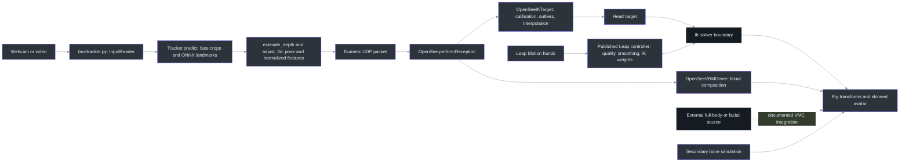
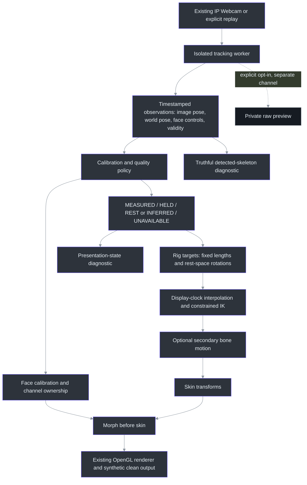

# VSeeFace research: what creates the smooth result, and what TrickRoom can learn

Research date: 2026-10-12. **Research only: no application changes, dependency installation,
VSeeFace installation, camera access or additional processing of the private test video.**

This is the pre-implementation research snapshot. The subsequently authorized
[core motion upgrade](15-core-motion-upgrade.md) implements a subset of these recommendations;
the comparisons below describe the code at the time of research.

## Executive conclusion

We do not need to abandon Python. OpenSeeFace, VSeeFace's webcam tracking backend, is itself
Python using OpenCV and ONNX Runtime. The important difference is the character-animation
system between tracking results and the rendered mesh: calibration, quality gates,
interpolation, constrained rig targets, facial composition and graceful loss handling.
Those mechanisms are portable concepts, not benefits exclusive to Unity or C#.[O1], [O2], [O3], [O4]

However, VSeeFace is **not documented as a perfect single-webcam full-body tracker**. Native
webcam tracking supplies the face; optional hands use Leap Motion. Full-body data can come
from VR tracking, Perception Neuron, ThreeDPoseTracker or other VMC senders. Some body motion
is an IK solution inferred from limited targets rather than a measurement of every joint.
Its own documentation discusses tracking loss, jitter, lighting failures, false face
detections and rig problems.[V1], [V2], [V3], [R1]

**Best direction for TrickRoom:** retain the current camera pipeline and GLB contract; build
a stronger, explicitly labelled avatar-motion layer around the existing fixed-length rig
path. Evaluate world-space pose directions, temporal interpolation and per-part pose
handover before assuming the entire tracker must be replaced. A face-backend comparison is
a separate experiment, not a justified wholesale switch today.

## 1. Scope, sources and confidence

The official VSeeFace site identifies v1.13.38c5 as the current download at retrieval.
It states that the application is not open source because it includes proprietary assets,
while pointing to public tracking/animation code. Public examples therefore provide strong
evidence for their own behavior, but not proof of every setting or implementation in the
current closed application.[V1], [V4]

| Evidence | What was examined | Boundary |
|---|---|---|
| VSeeFace official site | About, manual, FAQ, model requirements, expressions, VMC, phone/VR/full-body inputs, privacy, troubleshooting and performance | Documentation, not an instrumented run |
| Release history and English interface strings | Body/neck stiffness, loss transitions, interpolation fixes, source ownership and later phone-blendshape compatibility | Historical changes are distinguished from current implementation |
| OpenSeeFace | README, tracker/capture-to-UDP path, receiver, IK target, interpolation, expression recognition, VRM facial driver and process lifecycle | Pinned public source; not a binary-equivalence audit |
| Public Leap controller | Acquisition, quality rejection, hand mapping, smoothing, IK weights and loss/reacquisition | Published reference code; exact current application configuration unknown |
| VSeeFace SDK | README, configuration/animation components and avatar-validation path | SDK/editor code is not the full runtime |
| OpenSeeFace sample | Scene instructions and bundled UniVRM spring implementation | Historical sample, not a claim about current solver defaults |
| RootMotion | VRIK author's explanation of the limited-target full-body problem and solver stages | Primary design explanation, not inspected proprietary solver source |
| TrickRoom | Actual current tracking, state, smoothing, procedural avatar, GLB retargeting/skinning, presentation and UI loop | Local implementation evidence |

Pinned OpenSeeFace revision: `50c09741897010faad721a218b2bbe14ecad6251`.
Pinned SDK revision: `463333ef9f1c2eb303e402353d6fadc14262cc4f`.
Sample revision: `fe6b7ddab6d530272b1f9539801e447c7f907c4a`.
English interface-string revision: `6e5de93884eb64670967103edb9cf408057c9263`.
The separately published Leap-controller snapshot has SHA256
`01f4d9a878e715a36720b62208a9ab85e18bfb306336b7f74b57982eb9ba42ee`.
Public source copies used for inspection are under `.local\research\vseeface`.

Throughout this report:

- **CODE / high confidence** means the stated behavior was traced in the named implementation.
- **DOCUMENTED** means the relevant author/vendor states it; it was not independently measured here.
- **PROPOSAL** means a suggested TrickRoom experiment, not an implemented or proven improvement.
- **UNKNOWN** means source or comparative evidence is missing.

## 2. What VSeeFace actually tracks

| Visible behavior | Documented input or mechanism | What it does not establish |
|---|---|---|
| Webcam head, gaze, blinks, brows and mouth | OpenSeeFace facial tracking | Whole-body pose measurement |
| Detailed hands/fingers | Leap Motion device and hand-to-rig integration | Equivalent detail from sparse webcam pose landmarks |
| Full-body VR motion | External tracking sent through VMC | VSeeFace independently measured those body joints |
| Webcam full-body motion | An external sender such as ThreeDPoseTracker | Native OpenSeeFace is a body tracker |
| "Perfect Sync" | A compatible facial-data source and the required ARKit-style blendshape clips | Perfect accuracy, or reconstruction of missing image detail |
| Hair/accessory/clothing movement | Rigged secondary motion and supported simulation components | Camera measurement of every moving strand or fabric vertex |

VSeeFace explicitly documents these sources and the ability to combine them. For example,
external VMC body motion can coexist with VSeeFace face features. Its ThreeDPoseTracker
section also distinguishes the application's permitted uses from the source's
non-commercial restriction; it is not a dependency we should casually copy.[V1], [V2], [V3], [S1]

The RootMotion author makes the central distinction especially clear: a head and two
controllers provide too little information to uniquely determine a full-body pose.
VRIK combines analytic and heuristic stages to select a plausible, balanced result.
The article describes spine/chest estimation, procedural footsteps, leg solving and
shoulder/arm rules. An exact solution to a chosen limb-target problem is **not** the
same as an exact reconstruction of the person.[R1]

## 3. Publicly traceable data flow

This diagram separates inspected public code from documented application integration.
It is not a reverse-engineered map of all closed VSeeFace internals.



The capture loop constructs `Tracker`, calls `predict`, serializes timestamps, confidence,
pose, landmarks and features, then sends numeric UDP data. The receiver reconstructs
`OpenSeeData`; it does not receive the original image. `OpenSeeIKTarget` and the facial
driver consume that data through separate paths.[O2], [O3], [O10], [O4], [O6:Updates]

The public sample scene says its existing head setup uses FastIK and recommends assigning
the kinematic-interpolation object as a VRIK head target. The Leap controller directly sets
VRIK arm targets and weights. The precise full-body solver configuration used by current
VSeeFace remains outside the inspected public code.[P1], [H1]

## 4. Mechanisms behind the polish

### 4.1 A facial tracker optimized for animation, not just landmark count

**CODE:** `Tracker.predict` reuses prior face rectangles, adds detections when needed,
expands crops, performs landmark inference, selects confident candidates and calls
`estimate_depth`. The default model consumes a 224x224 face crop. Head pose uses
`cv2.solvePnP` with a canonical face and previous pose estimate; it is not a physical
depth measurement.[O2:Tracker.predict], [O2:Tracker.estimate_depth]

`FaceInfo.normalize_pts3d` removes a nose-relative offset/orientation and normalizes scale.
`Feature` maintains a median and expression range, then filters normalized feature values.
`FeatureExtractor` converts geometry into eye, brow and mouth controls. This helps separate
head movement and personal facial proportions from animation control values.[O2:Feature], [O2:FaceInfo]

OpenSeeFace also contains optional 3D-face adaptation, but the VSeeFace launch recipe sets
`--no-3d-adapt 1`. Its release history says this was enabled to stabilize expression detection
and prevent drifting behavior. We should not present every experimental OpenSeeFace feature
as an enabled VSeeFace accuracy advantage.[V8]

**DOCUMENTED:** the OpenSeeFace author explicitly says its landmarks are optimized for
useful avatar animation rather than exact face-image fitting. The README reports strengths
and weaknesses relative to MediaPipe, including weaker eye-region accuracy in some cases.
Those are author observations, not a controlled benchmark on our recording.[O1]

**Implication:** 478 landmarks versus 66 facial landmarks does not by itself decide which
system produces the better avatar. Stable, well-calibrated controls matter. Nor does changing
the backend recover information absent from a small or compressed face crop.

### 4.2 Neutral calibration and outlier rejection before moving the rig

**CODE:** `OpenSeeIKTarget.RunUpdate` rejects poor 3D fits, ignores initial samples, only
processes new timestamps, converts coordinate conventions and calibrates a neutral rotation
and translation. It rejects sudden angular/positional changes for bounded periods and can
optionally recalibrate persistent positional offsets. It then applies translation scaling,
smoothing and optional vertical-motion suppression.[O4]

This does not make the sensor perfect. It makes the puppet less willing to reproduce a
single implausible observation. The public example's fixed thresholds are not universal
defaults suitable for our camera, full-body framing or motion speed.

**TrickRoom lesson:** represent quality and discontinuities explicitly. Evaluate a
time-aware plausibility gate and an explicit calibration state, rather than merely lowering
confidence until a desired result appears.

### 4.3 Interpolation is different from smoothing

**CODE:** the IK target interpolates between accepted samples on display updates. Its own
tooltip explicitly describes approximately one capture frame of additional lag.
`OpenSeeKinematicInterpolation` provides a separate velocity-aware interpolation path.
The facial driver's `TimeInterpolate` uses sample intervals for gaze and blink transitions.
These are separate from filtering new measurements.[O4], [O5], [O6], [O6:Face]

**DOCUMENTED:** VSeeFace's performance guide says that interpolation can make tracking at
15 or even 10 updates per second look acceptable. It does not claim those rates measure
more real movements than the camera supplied.[V5]

**Implication:** a smooth 60 Hz display can be driven by lower-rate measurements.
The trade-off is latency and potentially overshoot. We should prefer timestamp-based,
bounded interpolation and shortest-path quaternion handling over copying frame-count
heuristics or unbounded extrapolation.

### 4.4 Tracking loss is a pose transition, not an amputation command

**CODE:** the published Leap controller maintains acquisition history, rejects suspicious
motion/range changes, smooths target positions and rotations, and waits for several valid
hand frames. Its `Interpolate` method ramps VRIK arm position/rotation weights in, allows a
grace period on loss, then fades weights out while finger rotations return toward authored
defaults. The reference fields include a 0.25-second grace period and different fade-in/out
durations; these are illustrative settings, not recommendations for TrickRoom.[H1]
The inspected controller's relevant paths are `UpdateHandRepresentations:577-616`,
`LateUpdate:271-455` and `Interpolate:457-536` in the private research snapshot.

The key operation is **fading the influence of a tracking target on an existing rig**.
It is not deleting the arm mesh, and it is not claiming the missing hand is still measured.

VSeeFace itself also exposes `Reset pose on tracking loss`, a timeout and a transition control
in the English interface strings; release 1.13.36b made pose reset enabled by default.
This corroborates a product-level loss policy beyond the published Leap example.[V8], [V9]

**TrickRoom lesson:** an optional presentation policy could distinguish `MEASURED`, `HELD`,
`INFERRED/REST` and `UNAVAILABLE`, preserving a coherent avatar through short local losses.
The raw skeleton diagnostic must continue to show only eligible detections. Whole-source
staleness must still trigger the existing fail-closed behavior. VSeeFace's example fade
durations must not silently override our 600 ms freshness boundary.

### 4.5 Rig preparation is part of the solution

**DOCUMENTED/CODE:** VSeeFace requires VRM0, not VRM1. Its guidance stresses normalized
rigs, correct humanoid assignments, valid hand poses and registered blendshape clips.
The SDK exposes model-height/ground-offset overrides and disabling automatic arm twist
relaxers when a model supplies its own. These are concrete signs that scaling, bone axes
and twist distribution are treated as explicit integration problems.[V6], [S1], [S2]

**Important compatibility boundary:** our contract is self-contained GLB with authored rest
transforms, not Unity's normalized humanoid pose. We must not copy an identity-rotation
assumption into arbitrary GLB eye or limb bones. Our eye-bone path already derives gaze
relative to the animated head and authored rest orientation
(`src\trickroom\assets\retarget.py:200-235`).

Rig correctness also does not require abandoning the existing mesh format. Skinning, morphs,
rest transforms and semantic bone mapping are already available in TrickRoom
(`src\trickroom\assets\profile.py:10-81`, `assets\animation.py:48-98`).

### 4.6 Facial signals are remapped and composed deliberately

**CODE:** `BlinkEyes` uses separate open/closed thresholds, head-angle adjustments,
optional eye linking, optional winks, smoothing and interpolation. `UpdateGaze` adds
normalization, sensitivity, smoothing and a deadband. These are not just raw network
values written directly into a mesh.[O6:Face]

`OpenSeeBlendShapeProxy` aggregates repeated contributions using maximum values rather
than blindly adding them, normalizes competing visemes, and can suppress groups of
face controls when another source owns them. The SDK also associates animation clips
with expressions and exposes an explicit `disableIK` decision.[O6], [S3]

`OpenSeeExpression` has both threshold-based classification with hysteresis and per-user
SVM calibration. Its learned mode requires repeated predictions before changing the
expression and reports held-out confusion statistics. The code shuffles samples into
training and validation sets; for our experiments, hold out complete gestures or recording
segments instead of assuming neighboring video frames provide independent validation.[O7]

**Implication:** closed eyes should reach a genuinely closed eyelid pose, small resting
mouth noise should not repeatedly open the jaw, and multiple animation sources must not
fight over the same control. Expression labels here are animation triggers, not proof of
the person's emotional state.

### 4.7 Secondary motion adds life without adding sensing accuracy

**CODE:** the bundled UniVRM sample spring implementation advances bone tails using
previous motion, drag, a rest-direction term and external force; it constrains length and
handles sphere collisions before deriving a bone rotation. Its execution-order annotation
explicitly places the update after IK.[P2]

**DOCUMENTED:** VSFAvatar supports additional dynamics/cloth components and animations.[S1]

This explains why hair and accessories can look alive even when the camera is not tracking
them. For our PS1 character, small, deliberate hair/hoodie secondary motion could help the
look later. It will not fix pose acquisition or make finger movement measurable.

### 4.8 Process isolation is a concrete reliability and privacy lesson

**CODE/DOCUMENTED:** `facetracker.py` is a separate numeric-data producer.
`OpenSeeLauncher.StartTracker` starts the process, and its job-management helper associates
it with a Windows job configured for child cleanup. The official privacy section explicitly
distinguishes the image-owning tracker process from the avatar application.[O3], [O8], [O11], [V7]

TrickRoom has a good logical image-free observation boundary, but capture, inference and
UI live in one process. `Runtime._run` catches Python exceptions, not every native-process
failure (`src\trickroom\runtime.py:125-225`). Moving the model runtime into a bounded child
process would contain a class of failures that previously terminated our whole headless
test. **It would not identify or fix the root cause of those native crashes.**

The raw-debug exception must remain explicitly opt-in and separate if the process boundary
is strengthened; numeric observations must not become a convenient raw-image transport.

### 4.9 Body stiffness and source ownership are animation controls

**DOCUMENTED:** release 1.13.24 introduced a body-stiffness slider controlling how far the
head turns before the body follows. Release 1.13.32 added neck stiffness so a head tilt need
not pull the whole body with it. Later notes record separate movement/face interpolation
fixes, a wrist twist-relaxer fix, VMC reception interpolation and more granular wrist-versus-arm
source selection.[V8]

These are concrete examples of improving the mapping and composition around the sensor,
not evidence that a new neural model suddenly measured every bone perfectly. They also
show why an attractive demo is not a controlled comparison of raw tracking accuracy.

## 5. Concrete differences in our implementation

### The biggest newly verified gap: world pose is captured but not used for retargeting

`Tracker.process` reads MediaPipe `pose_world_landmarks` and places them in the
`Observation.world_joints` field (`src\trickroom\tracking.py:257-323`;
`src\trickroom\state.py:120-129`).

However, `assets.retarget.observed_points` currently constructs targets from normalized
image landmarks as:

```text
(x * image_width, -y * image_height, -z * image_width)
```

Both body basis and bone-aim calculations consume those points. There is no current
retargeting consumer of `world_joints` (`src\trickroom\assets\retarget.py:55-84,134-235`).
MediaPipe separately defines world landmarks as hip-centered 3D coordinates in meters.[M1]

**PROPOSAL:** compare using world landmarks for bone directions/bend planes while retaining
image landmarks for framing, eligibility and screen placement. This is not a claim that
the inferred world landmarks are metrically exact or necessarily better in every pose.
Filter the world signal separately; do not apply `Point.usable`'s0..1 image-coordinate
bounds to world coordinates (`src\trickroom\state.py:81-89`).

### What already exists versus what is genuinely missing

| Area | Current verified behavior | Research-derived gap or experiment |
|---|---|---|
| Tracking/render separation | Worker and latest numeric observation | Native failure containment across a process boundary |
| Motion filtering | Time-aware One Euro on image joints and head pose | Render-time pose interpolation and richer quality states |
| Imported humanoid | Fixed local translations, rest-aware FK, four-weight skinning, morph-before-skin | Joint limits, stable bend planes and selected IK targets |
| Procedural built-in | Parts scaled from current observed shoulder/limb distances | Stable rig dimensions or use the rigged-avatar path for production-quality evaluation |
| Missing data | Immediate part/triangle omission according to eligibility | Optional bounded pose handover without relabelling inferred limbs as tracked |
| Face controls | Immediate normalized coefficients mapped to 12 logical shapes | Neutral/range calibration and per-channel response shaping |
| Gaze | Explicit morph or rest-aware eye-bone mode | Preserve this exclusivity; add calibrated response only if evidence supports it |
| Placement | Held scale plus hips/shoulders/face anchoring | Evaluate anchor-switch hysteresis and world-space orientation separately |
| Animation clips | Bind/live/clip modes are exclusive | Explicit per-region composition, not accidental competing writers |

Local evidence:

- `filters.py:11-95` resets filters on missing points/time gaps and deliberately leaves
  expression coefficients immediate.
- `studio.py:599-675` obtains the latest observation and draws it; there is no bracketing
  live-pose buffer. `assets\retarget.py:278-309` caches live evaluation for the same observation.
  Increasing display frequency alone therefore does not synthesize intermediate poses.
- `avatar.py:653-740` scales procedural parts using current observed distances and skips
  a limb when an endpoint is missing.
- `assets\retarget.py:134-235` preserves authored local translations while changing rotations.
  The same file's `evaluate` method hides triangles whose dominant drivers are unavailable.
- `assets\presentation.py:22-44,109-177` holds calibrated scale and chooses image-space anchors.
- `assets\animation.py:20-98` already has quaternion clip interpolation and morph-before-skin
  deformation. Those are existing foundations to reuse, not new work to rebuild.

## 6. Recommended additions, in order

These are **proposals requiring implementation and comparison**, not completed features.

| Priority | Addition | Why it is worth trying | What must remain honest |
|---|---|---|---|
| P0 reliability | Isolated inference worker with bounded startup/shutdown and explicit failure state | A native tracker fault should not terminate the studio | Isolation is containment, not a proven crash fix |
| P1 motion foundation | Evaluate world-space targets through the existing GLB rig; keep authored lengths and rest transforms | Better separation of 3D articulation from screen-space placement | World pose is inferred; coordinate conventions need tests |
| P1 presentation | Timestamped rotation/target interpolation plus bounded loss/reacquisition blending | Reduces sample stepping and abrupt mesh/pose transitions | Held/rest poses are not new detections; stale input still clears |
| P1 face | Neutral calibration, per-control ranges, blink endpoint handling and explicit smoothing policy | Makes coefficients map more consistently to the authored face | Do not erase quick blinks or fake successful detection |
| P2 rig constraints | Two-bone limb IK, bend-plane continuity, angle limits and controlled twist distribution | More plausible limbs and stable endpoints | IK chooses a valid pose; it cannot observe hidden limbs |
| P2 backend experiment | OpenSeeFace face adapter beside the existing MediaPipe face path | A focused comparison of face availability/control quality | Keep body tracking; do not assume OpenSeeFace wins |
| P3 interoperability | Optional motion-only VMC input | Allows future external trackers without replacing rendering | It is a transport, not a tracker or accuracy upgrade by itself |
| P3 appearance | Restrained spring bones and explicit animation layers | Adds authored character life | Cosmetic motion is not measured motion |

For the first visual improvement experiment, prioritize a stable rig plus the presentation
layer over replacing the entire tracker. The previous recording was tested with the
procedural built-in, so its visible part behavior should not be mistaken for a failure of
the already implemented GLB skinning mathematics.

### Proposed architecture, not current behavior



For all-loss or stale-source cases, the policy must remain fail-closed rather than letting a
held avatar masquerade as live tracking. For local limb loss, any relaxed visual policy
must be opt-in and separately visible in diagnostics. Fade **pose/IK influence**, not mesh
opacity: the current GLB material contract does not need a new transparency feature for
that experiment.

## 7. Compatibility details that must not be skipped

### OpenSeeFace is not a drop-in replacement for our face object

OpenSeeFace's packet has 66 facial points plus two pupil points, 3D fit status/error and
eye-open values. Our private face-mesh view assumes MediaPipe's 468/478-point topology.
An adapter must declare its topology and validity; padding missing points to look like
MediaPipe would be false data. Eye-open and blink-closure conventions must be converted
explicitly, while retaining anatomical left/right and presentation-only mirroring.[O3], [O10]
(`src\trickroom\debug_views.py:94-154`, `state.py:93-117`)

The current body model supplies sparse wrist/index/pinky aims, not articulated finger
tracking (`assets\retarget.py:162-175`). VSeeFace's Leap-driven fingers cannot be obtained
by adding finger bones alone. A separate hand tracker or external sensor would supply
additional measurements and would need its own framing/performance qualification.

### "Perfect Sync" requires an intentional profile change

The main VSeeFace manual describes all 52 ARKit clips for full coverage. Its later release
notes are more permissive: 1.13.36m removed the all-52-present gate for iFacialMocap reception,
and 1.13.36p added translation for models without Perfect Sync shapes. Therefore, **full
52-control fidelity and basic receiver compatibility are different requirements**.[V3], [V8]

TrickRoom currently has 12 logical shape controls and a 32-morph-target limit **per primitive**,
not per entire avatar (`assets\profile.py:35-49,83-96`;
`assets\gltf.py:564-566`). A typical 52-target face primitive exceeds that limit; distributing
targets across meshes would not supply the missing logical control mapping. Supporting the
full repertoire requires a versioned profile, deliberate resource budgets, state/control
mappings, model-authoring changes and handbook maintenance. It should not precede making
the current 12 controls reliable.

### VMC can be a narrow adapter

VMC is OSC over UDP. The specification separates performers, receivers and assistants;
it defines root/bone transforms, blendshape values and an apply marker, but also unrelated
control messages. A future TrickRoom receiver should start with a bounded allowlist of
numeric motion messages, explicit bone/coordinate mapping and freshness checks.
It should not accept remote model paths, arbitrary configuration changes, keyboard
commands or camera control just because the broader protocol defines them.[C1]

Unity quaternion/vector conventions, GLB rest transforms, packet timing and source ownership
must be tested. Preserve authored bone translations where required instead of blindly
applying another avatar's proportions.

### Do not copy public examples verbatim

The public `PrettyEuler` helper has a concrete suspicious branch: while correcting a
positive Y wrap it increments X instead of Y (`OpenSeeIKTarget.cs:102-105`).
Other inspected code uses broad catches and frame-dependent smoothing. These observations
are reasons to implement and test the underlying ideas, not claims that every current
VSeeFace binary exhibits those behaviors. Our existing shortest-path quaternion helpers
and time-aware filtering should be preserved.

## 8. Model-authoring implications

Our Blender contract remains the authority for assets imported into TrickRoom. The useful
lessons from VSeeFace are to make that contract deliberately testable:

- Keep correct hierarchy, meaningful bone axes, valid inverse binds and bounded weights.
- Test shoulder/elbow/knee bends and authored rest orientation before live tracking.
- Include optional toes when foot-direction behavior is required.
- Test neutral plus combined facial controls; a blink and a smile must not unintentionally
  fight over eyelid/mouth geometry.
- Keep eye-bone and gaze-morph ownership exclusive.
- Add twist/secondary bones only with a matching runtime plan.
- Do not add 52 empty shapes or convert the entire pipeline to VRM merely to obtain a
  "Perfect Sync" label.

These build on the existing profile and handbook, not a new format requirement
(`assets\profile.py:10-81`, `assets\animation.py:63-98`,
`assets\retarget.py:100-130,200-235`). The reference-art Blender model remains separate
unfinished artwork; this research does not create or approve it.

## 9. How to evaluate improvements without fooling ourselves

The first recording's 96.74% pose presence, 39.88% full required skeleton and 69.99% face presence
are detector-availability measurements. They include whatever framing and occlusion occurred
in that clip. They are not a VSeeFace comparison, and they are not independent pose-accuracy
scores. The first-test reports remain private under `.local\video-checks\20261012-first`.

**Proposed evaluation sequence:**

1. Annotate representative full-body, close-up, turn, occlusion and reacquisition segments.
   Separate intentionally unobservable body parts from true detection errors.
2. Compare the same observations through the current procedural output and existing rigged
   output. This isolates presentation from detector quality.
3. Add world-space targets, then interpolation, then bounded handover one change at a time.
   Preserve the raw detection counters so prettier inferred motion cannot inflate them.
4. Evaluate face calibration before comparing an alternative face backend on the same inputs.
5. Test lower-rate input, frame-time variation and abrupt tracking loss using controlled data.
   A smooth clip alone is not enough.

| Measure | What it tells us | What it does not tell us |
|---|---|---|
| Visible-joint/face availability and gap durations | Acquisition and continuity | Anatomical accuracy |
| Annotated joint/gesture agreement | Whether the detected motion matches the input | Physical camera-to-display latency |
| Authored bone-length variation | Whether the renderer stretches the rig | Whether joint rotations are correct |
| Pose jumps and per-part handovers | Presentation discontinuity | Whether every fast motion was an error |
| Wink cross-talk and missed short blinks | Facial-control fidelity | Overall emotion recognition |
| Input-signal to rendered-response delay | Added software lag | Exposure/network/display latency without an external timing method |
| Frame time, process health and recovery | Reliability and rendering cost | Creative acceptance |

No A/B test, new benchmark, new calibration training or private-video upload was performed
as part of this research.

## 10. Licensing, privacy and unresolved boundaries

OpenSeeFace is BSD-2-Clause; preserve notices and review bundled model/dependency terms before
shipping a derived integration. Its README says release bundles contain a custom ONNX Runtime
without telemetry. The VSeeFace site makes the same distinction from stock runtime behavior.
This is directly relevant to our open SDK telemetry workstream, but installing stock
`onnxruntime` is not proof that the custom distribution's privacy behavior is reproduced.[O1], [O9], [V7]

Switching only the face backend would also leave the MediaPipe body backend in place;
it would not by itself resolve all of our current SDK telemetry questions.

The full VSeeFace application and paid Unity assets are not freely redistributable source.
No general SDK license was established from the repository license endpoint/tree; the visible
Unity-shader license is not blanket permission for everything. The separately published
Leap-controller gist also requires a provenance/license decision before copying. Use these
as design references unless reuse rights have been established.[V4], [S1]

VSFAvatar is a Unity asset bundle plus expected components, not a portable replacement for
our GLB reader. The SDK itself says third-party integration is not really supported and
requires compatible assets/runtime handling. Importing that ecosystem is not the recommended
route for TrickRoom.[S1]

The following remain **unknown or unverified**:

- Exact closed-application VRIK configuration, version-specific update order and all current
  runtime defaults.
- Whether OpenSeeFace improves our user's recorded facial tracking under a controlled comparison.
- How much of a particular online demo's motion came from extra hardware, external software,
  authored animation or manual tuning.
- Current end-to-end input-to-display latency and actual user comfort/acceptance.
- Independent network behavior of any proposed new binary/dependency build.

Several legacy VRM/FinalIK documentation links returned404. The conclusions above rely on
the successfully retrieved official VSeeFace material, pinned public code and the retrieved
RootMotion design article, not those missing pages. Gist API metadata was rate-limited;
the publicly linked raw controller was read and content-hashed instead.

## Sources

[V1]: https://www.vseeface.icu/#about
[V2]: https://www.vseeface.icu/#vmc-protocol-support
[V3]: https://www.vseeface.icu/#iphone-face-tracking
[V4]: https://www.vseeface.icu/#faq
[V5]: https://www.vseeface.icu/#performance-tuning
[V6]: https://www.vseeface.icu/#model-issues
[V7]: https://www.vseeface.icu/#faq
[V8]: https://gist.github.com/emilianavt/90bc0b73e2713276e6f630db09977eae
[V9]: https://github.com/emilianavt/VSeeFaceTranslations/blob/6e5de93884eb64670967103edb9cf408057c9263/en.json
[O1]: https://github.com/emilianavt/OpenSeeFace/blob/50c09741897010faad721a218b2bbe14ecad6251/README.md
[O2]: https://github.com/emilianavt/OpenSeeFace/blob/50c09741897010faad721a218b2bbe14ecad6251/tracker.py
[O2:Feature]: https://github.com/emilianavt/OpenSeeFace/blob/50c09741897010faad721a218b2bbe14ecad6251/tracker.py#L150-L324
[O2:FaceInfo]: https://github.com/emilianavt/OpenSeeFace/blob/50c09741897010faad721a218b2bbe14ecad6251/tracker.py#L326-L484
[O2:Tracker.estimate_depth]: https://github.com/emilianavt/OpenSeeFace/blob/50c09741897010faad721a218b2bbe14ecad6251/tracker.py#L764-L872
[O2:Tracker.predict]: https://github.com/emilianavt/OpenSeeFace/blob/50c09741897010faad721a218b2bbe14ecad6251/tracker.py#L1033-L1211
[O3]: https://github.com/emilianavt/OpenSeeFace/blob/50c09741897010faad721a218b2bbe14ecad6251/facetracker.py#L226-L363
[O4]: https://github.com/emilianavt/OpenSeeFace/blob/50c09741897010faad721a218b2bbe14ecad6251/Unity/OpenSeeIKTarget.cs#L7-L331
[O5]: https://github.com/emilianavt/OpenSeeFace/blob/50c09741897010faad721a218b2bbe14ecad6251/Unity/OpenSeeKinematicInterpolation.cs#L36-L104
[O6]: https://github.com/emilianavt/OpenSeeFace/blob/50c09741897010faad721a218b2bbe14ecad6251/Examples/OpenSeeVRMDriver.cs#L270-L524
[O6:Face]: https://github.com/emilianavt/OpenSeeFace/blob/50c09741897010faad721a218b2bbe14ecad6251/Examples/OpenSeeVRMDriver.cs#L1463-L1682
[O6:Updates]: https://github.com/emilianavt/OpenSeeFace/blob/50c09741897010faad721a218b2bbe14ecad6251/Examples/OpenSeeVRMDriver.cs#L1955-L2046
[O7]: https://github.com/emilianavt/OpenSeeFace/blob/50c09741897010faad721a218b2bbe14ecad6251/Unity/OpenSeeExpression.cs#L472-L639
[O8]: https://github.com/emilianavt/OpenSeeFace/blob/50c09741897010faad721a218b2bbe14ecad6251/Unity/OpenSeeLauncher.cs#L293-L416
[O9]: https://github.com/emilianavt/OpenSeeFace/blob/50c09741897010faad721a218b2bbe14ecad6251/LICENSE
[O10]: https://github.com/emilianavt/OpenSeeFace/blob/50c09741897010faad721a218b2bbe14ecad6251/Unity/OpenSee.cs#L33-L263
[O11]: https://github.com/emilianavt/OpenSeeFace/blob/50c09741897010faad721a218b2bbe14ecad6251/Unity/OpenSeeJobManagement.cs#L14-L89
[S1]: https://github.com/emilianavt/VSeeFaceSDK/blob/463333ef9f1c2eb303e402353d6fadc14262cc4f/README.md
[S2]: https://github.com/emilianavt/VSeeFaceSDK/blob/463333ef9f1c2eb303e402353d6fadc14262cc4f/VSF%20SDK/VSF_Configuration.cs#L6-L16
[S3]: https://github.com/emilianavt/VSeeFaceSDK/blob/463333ef9f1c2eb303e402353d6fadc14262cc4f/VSF%20SDK/VSF_Animations.cs#L14-L151
[H1]: https://gist.github.com/emilianavt/b211073096a4484fb92e6550212c2f48
[P1]: https://github.com/emilianavt/OpenSeeFaceSample/blob/fe6b7ddab6d530272b1f9539801e447c7f907c4a/Assets/Scenes/OpenSeeFaceSample.unity#L884-L890
[P2]: https://github.com/emilianavt/OpenSeeFaceSample/blob/fe6b7ddab6d530272b1f9539801e447c7f907c4a/Assets/VRM/UniVRM/Scripts/SpringBone/VRMSpringBone.cs#L8-L156
[R1]: https://root-motion.com/2016/06/inverse-kinematics-in-dead-and-buried/
[C1]: https://protocol.vmc.info/english.html
[M1]: https://developers.google.com/edge/mediapipe/solutions/vision/pose_landmarker/python#handle_and_display_results
