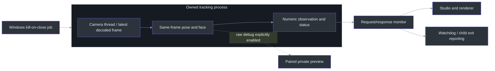
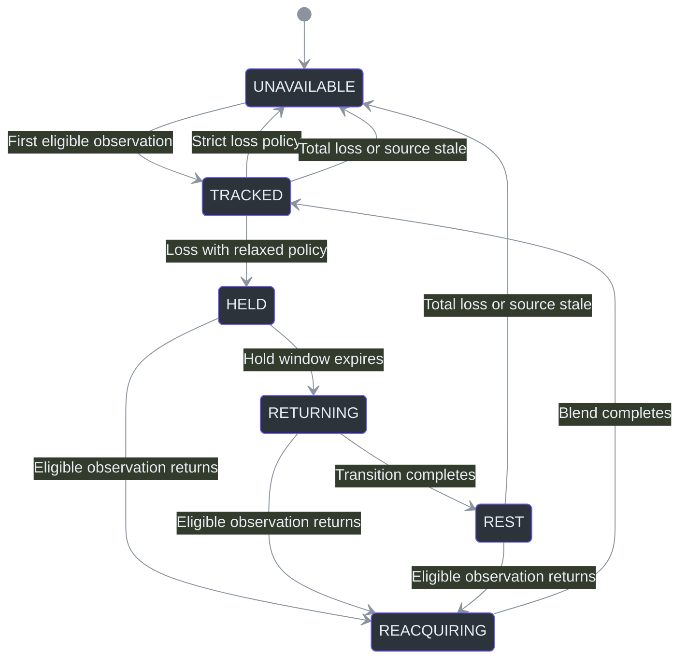

# Core motion upgrade

The first VSeeFace-informed implementation keeps Python, the existing camera inputs, the
reference character and the GLB Profile 1 contract. It adds native-worker containment and a
separate presentation layer for rigged models. It does **not** replace the detector, implement
VMC/OpenSeeFace, author the final Blender character or promise improved sensing accuracy.

## Use the new controls

```powershell
# No camera: inspect the new controls with the existing technical rig
.\Start-TrickRoom.ps1 -Demo -Avatar examples\blender\TrickRoom-Conformance.glb

# Explicit local recording; no live endpoint or embedded credentials
.\Start-TrickRoom.ps1 -Source "C:\your-folder\movement.mp4" `
  -Avatar examples\blender\TrickRoom-Conformance.glb

# Opt in to bounded missing-limb presentation and preset facial response
.\Start-TrickRoom.ps1 -Source "C:\your-folder\movement.mp4" `
  -Avatar examples\blender\TrickRoom-Conformance.glb -RelaxMissing -FaceResponse
```

The technical rig is a conformance fixture, not a replacement for the reference art.
Use **Load Blender GLB** for your prepared model and select `live`.

For an interactive recording test, **Test from video...** selects the input and switches the
current GLB from authored preview to tracking mode. **Replay last video** repeats it after EOF
or Disconnect. Input is explicitly labelled as replay; private raw preview remains opt-in.
The Studio-only bottom timeline adds pause/resume and seeking. A seek resets native tracking,
rig/scale/interpolation and expression-filter history while retaining completed neutral/range
calibration and gains. Unfinished calibration cancels; calibration cannot start while paused.
Paused numeric output is explicitly labelled and does not advance detector counts. Raw preview
still expires. See [timeline controls and timing limits](01-camera-and-studio.md#bottom-playback-timeline).

| Control | Default | Meaning |
|---|---|---|
| Enhanced motion (GLB only) | On | Use the new rig path, interpolation and state reporting |
| Rig coordinates | `world` | Use eligible world-pose directions; `image` is a comparison option |
| Constrain limb bend/twist | On | Use bounded two-bone solving and a stable near-straight bend plane |
| Relax lost limbs (not tracked) | Off | Keep previously observed regions as labelled held/returning/rest poses |
| Shape facial response | Off | Remap and selectively filter expressions without replacing detector values |
| Neutral (1s) | Explicit action | Capture a stable neutral face into memory for this session |
| Range (3s) | Explicit action | Capture control excursions after neutral calibration |
| Clear face calibration | Explicit action | Discard personal calibration; disable response shaping |

`-NoRigMotion` / `--no-rig-motion` restores the legacy strict image-space rig.
`-RigSpace image` keeps enhanced temporal processing while changing its coordinate input.
`-NoRigConstraints` disables the limb solver. Flags are also available directly from
`python -m trickroom --help`.

**The built-in reference character remains the procedural path.** Facial response and process
isolation apply to it, but GLB interpolation/constraints/relaxed regions do not. No invisible
conversion to a different avatar is performed.

## 1. Native tracking is an owned child process

The child owns camera decode/rotation, both tracking tasks and the latest captured image.
The studio requests bounded snapshots, with only one request outstanding. Ordinary messages
contain observations, status and timing, not images. Explicit raw debug adds a separately
paired input frame at up to 15 Hz.



Startup is gated until the parent establishes ownership. Windows job closure kills only the
owned child if the studio disappears. Startup has a 20-second response bound; active response
and shutdown monitoring use a 5-second bound. Unexpected exit, timeout, invalid response or
forced termination is an explicit error and clears observations. It is not silently restarted.

This contains native-worker failures; it does not identify or repair the earlier native DLL
failure. Nor is the child a network sandbox: the documented MediaPipe telemetry caveat remains.
Face-debug connectivity is now packaged static licensed data, so opening that view does not
import MediaPipe into the studio process.

Implementation: `runtime.py::_tracking_worker`, `Runtime._run`, `Runtime._abort`,
`worker_lifetime.py::WorkerJob`, `debug_views.py::face_connections`.

## 2. World-space articulation, image-space placement

`Observation.world_joint` requires both an eligible image joint and finite/confident world
coordinates. It does not apply image-coordinate 0..1 bounds to world coordinates. World
points have independent One Euro filters; they are still model estimates, not physical-room
measurements.

Enhanced rig posing uses `(x, -y, -z)` world directions. The image remains the source of framing,
placement and availability; there is no silent fallback from missing world data to image
directions. Authored node translations and bone lengths are retained.

The limb solver uses a two-bone analytic reach calculation with a maximum 170-degree flexion,
and preserves the last usable bend plane near a straight limb. Rest-space axes and the bend
plane orient the bones. This is not full-body collision, shoulder biomechanics, finger capture
or foot-contact IK. The constraint toggle supports comparisons when the estimate is unsuitable.

The authored and solved limb frames use the same signed plane normal
(`cross(lower_direction, upper_direction)`). Opposite signs introduce a half-turn around
the bone even when its endpoints look correct, collapsing mixed pelvis/thigh skin weights.
Unconstrained aiming also starts from the driven ancestor's orientation, and remembered
near-straight planes follow that body frame during turns. These are runtime orientation
corrections; they require restarting an already running application, not re-exporting a
valid GLB or widening its waist.

**Model size follows current framing automatically.** Display scale compares eligible image-space
spans with the same spans projected from the posed rig, rather than treating inferred depth as
screen size. At least three usable limb/shoulder/hip/torso spans are required; nearly end-on or tiny
spans are excluded. Their median determines one uniform scale, filtered in log space once per
observation. It does not rescale individual bones.

This replaces the original first-frame scale latch, which could retain an initial close-up scale
after the person stepped back. **Recalibrate** now clears scale/pose smoothing history; it should
not be necessary just to follow changes in camera distance. Missing scale evidence is held only
briefly, then cleared; source timing/size changes reset it. Head-only fallback remains separate.
Different avatar proportions still need not align every joint pixel-for-pixel with the person.

Implementation: `state.py::Point.reliable`, `Observation.world_joint`,
`filters.py::MotionSmoother.apply`, `assets\retarget.py::observed_points`/`retarget`,
`assets\kinematics.py::solve_limb`, `assets\presentation.py::calibration_ratio`,
`assets\retarget.py::AvatarInstance.update_scale`.

## 3. Temporal presentation is not new detection

The rig keeps at most eight pose samples. A display-time sample blends local rotations using
shortest-path quaternion interpolation and eligible image anchors linearly. The presentation
clock accounts for inference/transport age and adds a default one-frame (33 ms) interpolation
delay. It never moves backwards or extrapolates beyond the latest sample.

The graphics scheduler aims for 60 Hz with enhanced imported rigs, otherwise 30 Hz. Both are targets,
not measured guarantees; an 8 ms minimum Tk yield remains. A dedicated graphics thread owns
avatar/numeric-debug rendering, while a separate 16 ms UI loop services controls and stale-display
revocation. Renderer mutations are queued to that owner. Personal facial coefficients are
not delayed with body rotations, avoiding erasure of brief blinks.



Strict missing-part visibility remains the default. With **Relax lost limbs** enabled:

- A previously seen region holds its last displayed pose for up to 150 ms since its last
  accepted capture, then blends toward the authored local rest rotation over 200 ms.
- Reacquisition blends from the last displayed pose instead of snapping.
- Never-observed regions remain unavailable.
- Total detection loss clears retained history. Source observations older than 600 ms clear
  all live geometry; rest poses never extend the source-freshness deadline.

The HUD and control panel label held/rest regions as **not tracked**. Raw skeleton/face views,
body-status labels, confidence and detector counters continue to reflect observations only.
`REST` means the asset's authored rest pose, which can be a T-pose; it is not a relaxed idle
animation. Bind/clip preview remains separate.

When face tracking drops out but pose head anchors remain available, head/eye offsets switch
to the current pose-derived values immediately. Only the parent neck/body continues its
ordinary interpolation; a previous face rotation must not turn a rear-facing head toward
the camera after that face observation is gone. Valid facial head rotations remain independent
of torso orientation. This does not reject uncertain detections or claim hidden-head accuracy.

Paused replay can deliberately freeze its selected numeric sample for inspection. This is not
another held/rest tracking state and does not make unavailable joints observable. Its original
timestamps remain intact; only explicitly paused recorded input gets this presentation exception.

Implementation: `assets\motion.py::RigMotion`, `assets\retarget.py::AvatarInstance.evaluate`,
`render.py::Renderer.render`, `studio.py::Studio._update_telemetry`.

## 4. Session-local facial response

Calibration is never automatic and is rejected for scripted demos. Neutral capture requires at
least 12 fresh samples and rejects a highly varying neutral segment. Range capture updates only
controls with meaningful excursions; the UI reports how many were observed. Face loss or
staleness cancels an in-progress capture explicitly.

Per-channel gains cover left/right blinks, jaw, smile, left/right brows and two gaze axes.
Blinks are remapped directly to open/closed endpoints without low-pass filtering, preserving
one-frame winks. Jaw, smile, brow and gaze use distinct short time constants. All values remain
bounded. Missing faces still clear facial controls rather than holding a smile indefinitely.

Only a presentation copy changes. Raw observations, landmarks, debug panels and detector meters
remain unchanged. Personal neutral/range samples stay in memory and are discarded on source
changes or calibration reset. No biometric profile file or automatic calibration export exists.

Implementation: `face_response.py::FaceResponse`, `render.py::Renderer.reset_motion`,
`studio.py::Studio.calibrate_face`, `Studio.clear_face_calibration`.

## Verification and limits

The focused and native checks cover subprocess faults/timeouts, Windows ownership, paired raw
preview revocation, world-coordinate validity, constant rig lengths, delayed-arrival interpolation,
loss/reacquisition labels, independent one-frame winks and actual controls.

`tools\verify_motion_upgrade.py --video <explicit-file>` compares legacy and enhanced rig
presentation on every decoded frame. It saves aggregate counts and synthetic-only images, not
raw video frames or landmark arrays. Both modes use the same observations; this cannot prove a
detector accuracy improvement.

The limb-frame regression (`tests\test_rig_twist.py`) additionally checks that rest observations
and rigid full-body turns recover the authored rotations, not merely finite matrices and fixed
bone lengths. The October13 repair was compared on every frame of the same supplied recording
and GLB: near-collapsing hip-matrix samples were eliminated in that run. A fresh native Studio
also checks front, rear and leaning cases with constraints enabled. See
`docs\evidence\limb-frame-twist-validation.json`; no new model export is required for that fix.

Current private evidence is under `.local\motion-upgrade`. Artistic acceptance, a final
reference-style Blender rig, full-body ground-truth accuracy, native DLL root cause, SDK telemetry
policy, external motion protocols, alternative face backends and secondary simulation remain
separate work.
