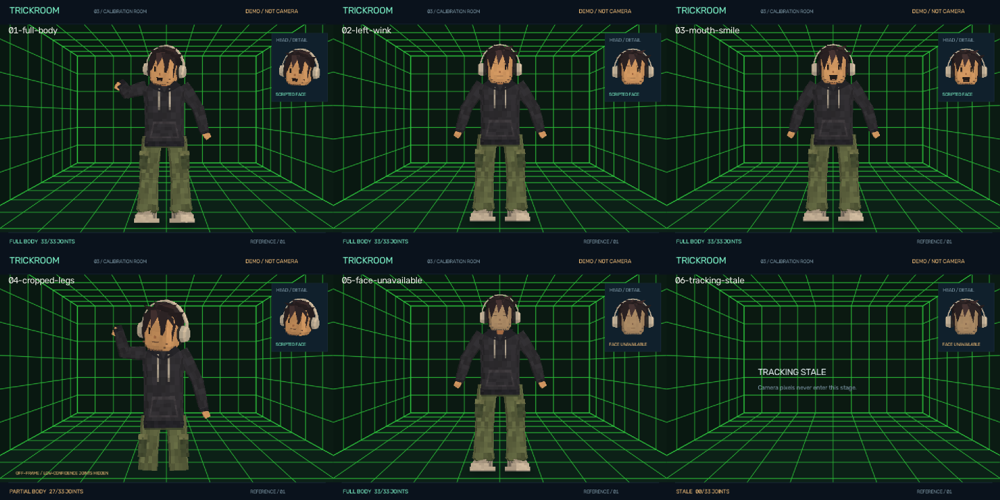

# TrickRoom engineering documentation

This documentation describes the first implemented prototype and its evidence boundaries.
It is maintained with the source, not copied from the earlier cardboard-avatar project.

## Reading paths

- **Use the prototype:** [camera and studio](01-camera-and-studio.md), then
  [validation and troubleshooting](05-validation.md) and [private debug views](13-debug-views.md).
- **Understand the design:** [scope](00-scope-and-acceptance.md),
  [architecture](02-architecture.md), [tracking](03-tracking-and-confidence.md),
  [rendering](04-synthetic-rendering.md), [reference character](10-reference-avatar.md),
  [perspective lab](11-perspective-lab.md).
- **Continue development:** [workflow](06-development-workflow.md),
  [future Blender direction](07-blender-and-roadmap.md), [source map](08-source-map.md),
  [TODO catalogue](../TODO/00_INDEX.todo), [development journal](../JOURNAL.md).
- **Create an importable Blender avatar:** [model quick start](12-blender-models.md),
  [83-page handbook](TrickRoom-Blender-Authoring-Handbook.pdf) and [offline HTML](book/index.html).
- **Audit claims:** [validation](05-validation.md), [source/model references](09-references.md),
  [third-party notes](../THIRD-PARTY.md).
- **Research motion improvements:** [VSeeFace/OpenSeeFace tracking and rigging analysis](14-vseeface-research.md).
- **Use the implemented core upgrade:** [rig motion, process isolation and facial calibration](15-core-motion-upgrade.md).
- **Review a model from another chat:** [CLI video export and model-review workflow](16-cli-video-rendering.md).

## Visual guide

The contact sheet demonstrates the renderer with authored values: full body, one wink, mouth/
smile, cropped lower legs, unavailable face and stale tracking. It is not a camera recording.
The generator and SHA256 manifest are in `tools\render_gallery.py` and `docs\images\manifest.json`.

The turnaround uses explicitly authored poses to inspect the model. It does not claim the
camera can acquire facial expressions from the back of a head.

The project has three separate evidence classes:

1. **Synthetic/unit:** controlled contracts, motion, expressions and failures.
2. **Actual inference on public fixtures:** real model execution, including known failures.
3. **Owner-source evidence:** basic live acquisition and a first supplied-recording pass exist;
   full motion accuracy, live reliability, framing and feedback remain unqualified.

Do not substitute one for another or mark live qualification complete from the demonstration.
