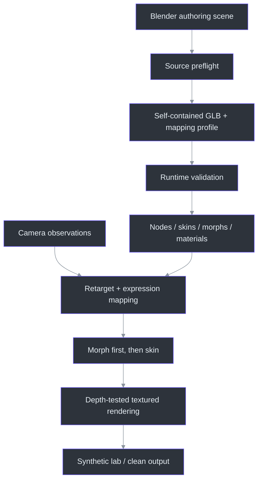
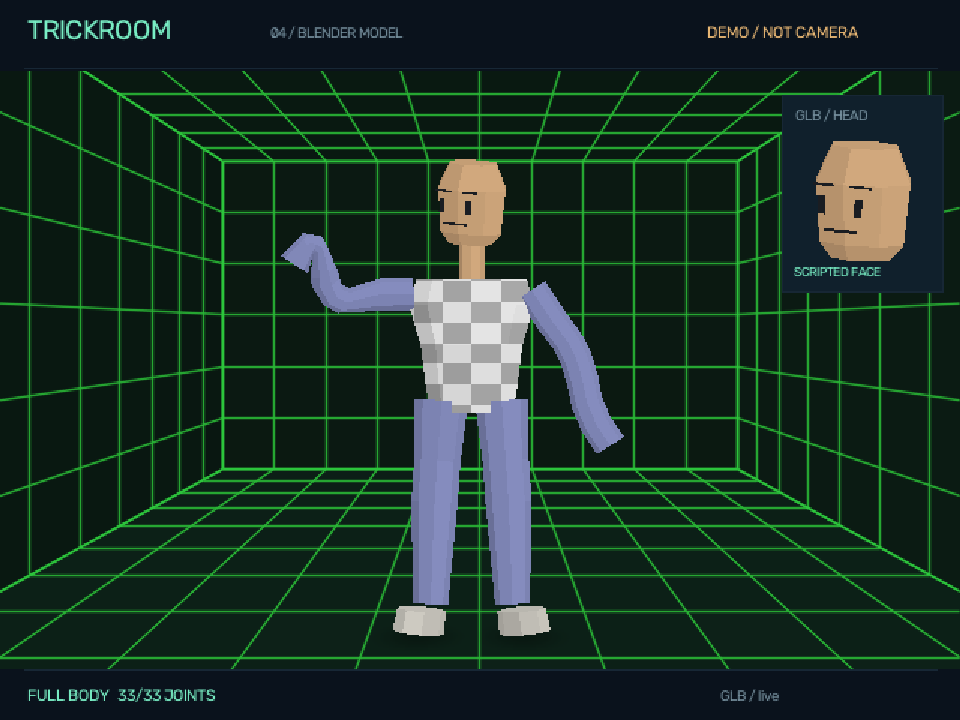
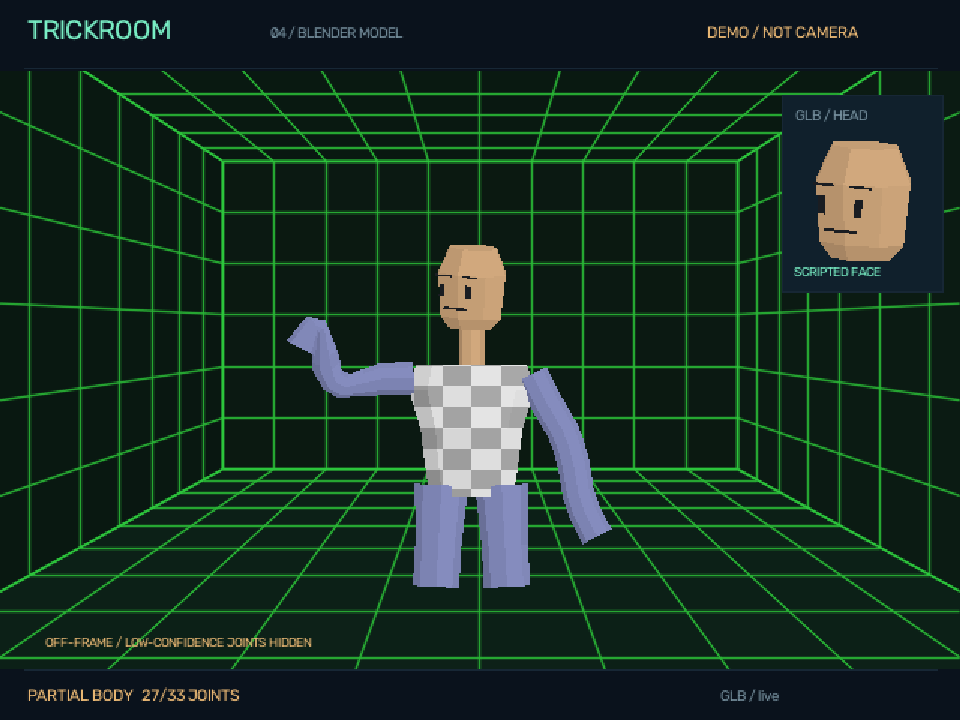
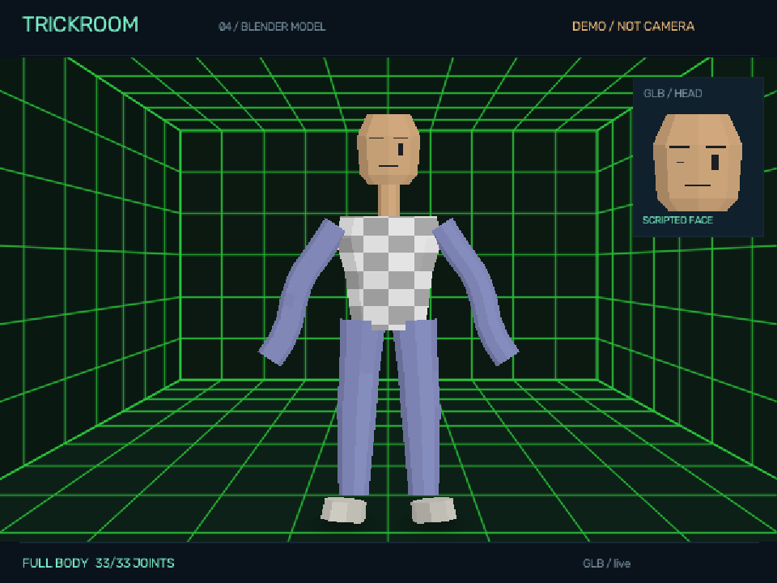
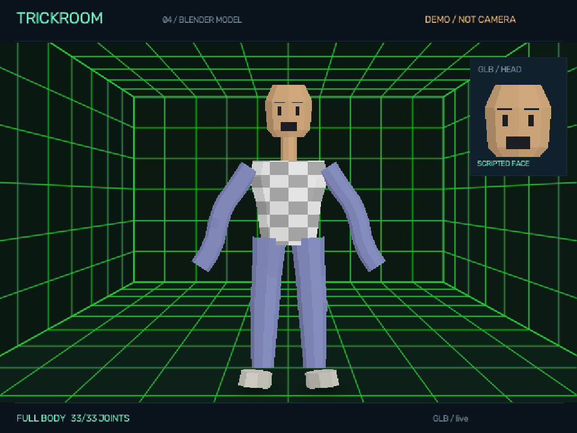
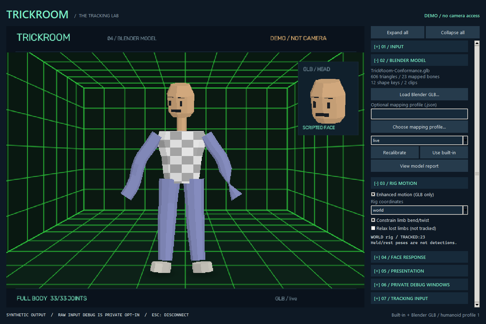
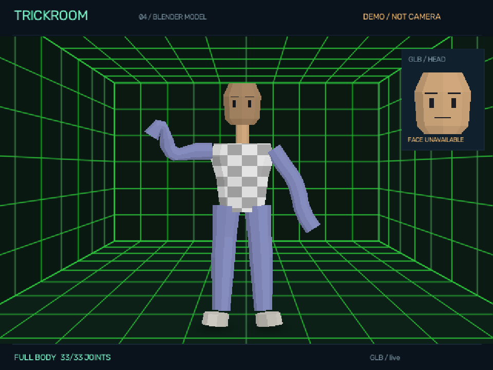
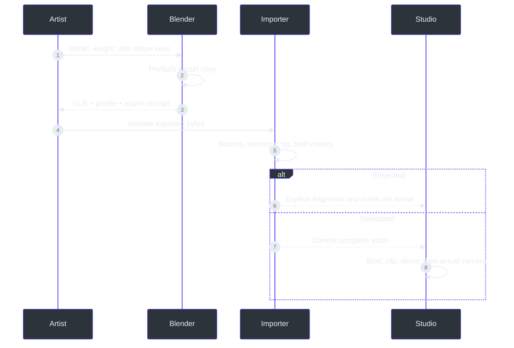

# TrickRoom Blender Avatar Authoring Handbook

## 01. The deliverable you are building

### Start with a runtime character, not a beautiful still

A successful TrickRoom character is an asset that survives a pipeline. Its silhouette must read,
its joints must deform, its facial controls must be independent, its materials must export, and
the resulting file must produce predictable movement in the application. A polished Blender
render is useful artistic evidence, but it does not prove any of those runtime properties.

The supported delivery format is a self-contained **glTF 2.0 binary file, `.glb`**. Keep the
editable `.blend` as the authoring source. TrickRoom does not open Blender projects, execute
drivers, run Geometry Nodes, evaluate constraints, or import arbitrary FBX/VRM assets at runtime.
You export the evaluated information that the runtime understands.

The implementation supports node hierarchies, linear blend skinning, four vertex influences,
named facial morph targets, embedded PNG/JPEG base-color textures, vertex colors, opaque or
alpha-mask materials, double-sided surfaces, diffuse/unlit appearance, and linear/step animation
clips. These are concrete features, not a promise that every glTF extension is implemented.

The existing reference character remains available. The included Blender conformance character
is deliberately simple and original: it proves the import contract without claiming to be the
final art. Do not replace your creative direction with its appearance merely because its tests pass.

### Delivery package

| File | Purpose |
|---|---|
| `Character.blend` | Editable meshes, deform armature, shape keys and actions |
| `Character.glb` | Self-contained runtime asset |
| `Character.trickroom.json` | Optional bone/shape mapping and gaze mode |
| `Character.export.json` | Export-helper receipt, hashes and source preflight |
| Validation report | Actual importer result for these exact exported bytes |

Use revisioned filenames while iterating. A previous good GLB is more useful than an overwritten
file whose relationship to the current `.blend` is unclear. Never count a saved file path as
proof that an export completed or that the application accepted it.

### Acceptance checkpoint

Open the GLB in TrickRoom's bind preview, play an exported action, return to live mode with the
synthetic demo, exercise the facial states, and then qualify the actual phone framing. Record
those as different evidence classes. The final step requires your real environment and judgment.

Implementation: {{source:src/trickroom/assets/profile.py::RigProfile}};
{{source:src/trickroom/assets/gltf.py::load_asset}};
{{source:src/trickroom/assets/retarget.py::AvatarInstance}};
{{source:src/trickroom/render.py::Renderer.load_model}};
{{source:tools/blender/export_character.py::export}}.

## 02. Understand the complete pipeline

### Why the stages are separate

Blender owns authoring. The exporter owns serialization. The importer owns validation. Tracking
owns observations. Retargeting owns the relationship between observations and bones. Skinning
owns vertex deformation. Rendering owns the final synthetic image. Keeping these responsibilities
separate makes a failure diagnosable: a texture-export problem should not be mistaken for a
tracking problem, and a bad bind pose should not be hidden by camera calibration.



The live path preserves the model's authored bone lengths. It does not scale every limb
independently until its endpoints coincide with the camera landmarks. That distinction matters:
stylized proportions remain your character's proportions. Different body proportions can leave
a visual offset between a diagnostic joint and the rendered hand. That is not automatically
an importer defect.

The facial path modifies mesh positions with shape-key deltas before applying skinning.
Therefore, an eyelid closure authored on the neutral head follows the head when it turns.
A shape that was sculpted in a posed or transformed coordinate system will not be rescued
by this order; it must first be corrected in Blender.

The presentation layer then places the deformed character into the synthetic stage. Model
preview modes do not require camera observations. Live mode requires current observations and
uses the existing confidence/freshness rules. Neither path provides raw camera pixels to the
renderer.

A later explicit debug option can show the unmasked processed input in its own private
window, alongside separate black-background skeleton and face-landmark windows. These views
start off and never enter the avatar or clean-output image. They are ordinary visible windows,
so disable raw debug before capturing a whole desktop.

Capture and native model inference now run in an owned child process. The studio receives
numeric observations; only explicit raw debug adds paired pixels on a separate path. This
contains worker failure, but does not remove the prebuilt SDK's usage telemetry.

### Diagnose by stage

If the bind preview is wrong, investigate export, transforms, indices, materials and bind data.
If a clip is wrong while bind is correct, investigate keys, interpolation and action export.
If clips are correct but live movement is wrong, investigate mapping, bone axes, proportions
and the observed pose. This ordering avoids repeatedly changing art to compensate for a
tracking condition.

Implementation: {{source:src/trickroom/assets/gltf.py::load_asset}};
{{source:src/trickroom/assets/animation.py::deform}};
{{source:src/trickroom/assets/retarget.py::retarget}};
{{source:src/trickroom/assets/presentation.py::present}};
{{source:src/trickroom/raster.py::DepthRenderer.draw_textured}}.

## 03. Coordinates, units and orientation

### The exported contract

The runtime expects an upright glTF character with **+Y up, +Z forward, and anatomical left
on +X**. In Blender, the tested authoring arrangement is +Z up, character front toward -Y,
and anatomical left toward +X. Export with the glTF exporter's **+Y Up** option enabled.
The exporter converts the coordinate system; do not also rotate the mesh manually to
compensate for that conversion.

The reader reconstructs glTF column-vector transforms. JSON matrices are column-major and
are transposed into NumPy's matrix representation during reading. You do not need to hand-edit
matrix values; you need to deliver a clean scene whose exporter can describe its transforms.

| Property | Required authoring action |
|---|---|
| Scene scale | Work consistently in meters; use a plausible full-character size |
| Model height | Exported height must be between 0.1 and 10 scene meters |
| Object scale | Apply nonuniform and negative scale in a safe export copy |
| Bone scale | Keep positive and uniform; do not rely on animated squash/stretch |
| Facing | Verify a frontal bind preview before attempting live retargeting |
| Mirror | Do not bake an accidental negative-scale mirror into the armature |

Uniform positive transforms are mathematically supported, but an applied unit-scale export
copy is easier to reason about. A negative determinant changes handedness and triangle
winding; the importer rejects negative or nonuniform scales rather than guessing how to
repair skinning, normals and animation together.

### Practical axis check

Create a temporary visible marker on the character's anatomical left shoulder in Blender.
Export a test revision. In an unmirrored front view, that marker should be on the viewer's
right. Toggle TrickRoom's presentation mirror and it should move to viewer-left with the
whole character. Remove the marker after this check; do not solve a wrong export axis by
swapping all left/right names.

The model's forward axis is not the camera's raw pixel direction. TrickRoom preserves
unmirrored inference and mirrors only the final presentation. This protects the meaning of
left/right expression channels and bone mappings.

Implementation: {{source:src/trickroom/assets/gltf.py::_nodes}};
{{source:src/trickroom/assets/gltf.py::_rig}};
{{source:src/trickroom/assets/math3d.py::compose}};
{{source:src/trickroom/assets/math3d.py::decompose}};
{{source:tools/blender/export_character.py::export}}.

## 04. Plan the character before adding detail

### Define the silhouette and functional parts

For the current visual direction, identify the head/hair/headphones, hoodie, cargo trousers,
hands and sneakers as separate design concerns. They do not necessarily need to be separate
Blender objects, but their deformation requirements differ. A headphone cup should behave
rigidly with the head. A sleeve must bend around an elbow. A cargo pocket should remain
attached to the trouser surface without becoming a detached flap during a knee bend.

Establish the front, side and back silhouette before spending time on texture noise. Large
shape errors remain visible at the prototype's deliberately reduced rendering resolution.
Small details that disappear at the intended output size should not consume most of the
vertex budget.

The importer permits up to 80,000 exported vertices, 100,000 triangles and 64 primitives.
These are safety limits, not recommended PS1 art targets. Start much smaller and measure.
The technical conformance asset has fewer than one thousand exported vertices; the built-in
reference renderer is a different procedural representation and is not a target topology
for your Blender mesh.

### Decide what must deform

| Part | Typical preparation |
|---|---|
| Hoodie torso | Weighted across hips, spine and chest |
| Sleeve | Gradual upper/lower-arm blend around the elbow |
| Trouser leg | Hip/thigh/knee/lower-leg transition with enough bend geometry |
| Head and hair | Mostly rigid head influence, except intended facial shapes |
| Headphones | Rigid head skinning or bone-parented attachment |
| Eyes/mouth | Explicit facial geometry with independent shape-key behavior |

Do not use topology density as a substitute for good weights. A dense elbow with abrupt
one-bone weights still hinges badly. Conversely, a very low-poly elbow can work well if its
cross-sections and blend region match the intended bending range.

### A useful first review

Test a neutral stance, a raised arm, a bent elbow, a seated/crouched pose, a head turn and
a blink. Keep the review at the real output size, not only a zoomed Blender viewport.
Record which issues are silhouette, topology, weights, materials or tracking. Changing all
five categories simultaneously makes regression diagnosis unnecessarily difficult.

Implementation: {{source:src/trickroom/assets/profile.py::RigProfile}};
{{source:src/trickroom/assets/gltf.py::_primitives}};
{{source:src/trickroom/assets/animation.py::deform}};
{{source:src/trickroom/assets/presentation.py::present}};
{{source:tools/blender/preflight.py::validate}}.

## 05. Mesh topology, normals and exported vertex counts

### Why Blender and runtime counts differ

An exported vertex is not simply a visible point in Blender's edit mesh. A position may be
duplicated where normals, UVs, colors or material primitives differ. Sharp edges and UV seams
can therefore increase the exported count without adding an obvious new corner to the shape.
Budget against the importer report, not only Blender's source vertex count.

The tested conformance source contains 348 source vertices, while the exported asset contains
964 vertices across five primitives. Those extra vertices preserve the discontinuities required
by the exported attributes. The exporter is not necessarily duplicating them accidentally.

The runtime accepts triangle primitives. Blender's glTF exporter triangulates supported faces,
but controlling important diagonals yourself makes deformation and shading more reproducible.
Inspect long skinny triangles near elbows, lips and eyelids. A diagonal that crosses the wrong
fold can make a low-poly face look torn when its vertices move.

### Normals and shading

Export normals for intended flat or smooth shading. The loader checks that supplied normals
are finite and nonzero. Morph normal deltas are supported, and skinning transforms normals
through inverse-transpose joint transforms. If normals are absent, the renderer derives a
face normal, so the result is flat rather than a reconstruction of Blender's custom shading.

Recalculate outward normals in the export copy. A single-sided material hides back-facing
triangles; double-sided materials can hide a winding mistake but do not correct it. Use
double-sidedness intentionally for cards or thin surfaces, not as the default fix for a
broken closed mesh.

### Practical topology checks

- Check for loose vertices, zero-area faces and unintended internal surfaces.
- Inspect sharp/smooth boundaries with a simple neutral material.
- Keep mouth openings and eyelids closed where their closed states require coverage.
- Test the exact triangulated form that will be exported.
- Compare imported bind pose to the Blender export copy before adding motion.

Do not apply topology-changing modifiers after creating production shape keys unless you
understand how all target vertex correspondence will be preserved. The reusable preflight
asks for non-armature modifiers to be applied before the final export stage.

Implementation: {{source:src/trickroom/assets/gltf.py::_primitives}};
{{source:src/trickroom/assets/animation.py::deform}};
{{source:src/trickroom/assets/presentation.py::_batches}};
{{source:src/trickroom/raster.py::DepthRenderer.draw_textured}};
{{source:tools/blender/preflight.py::validate}}.

## 06. The canonical humanoid hierarchy

### Names have semantic meaning

Profile 1 maps logical body roles to glTF node names. The default names below are the easiest
path. A custom mapping can rename them, but it cannot remove the required anatomy or make an
unrelated hierarchy equivalent to a humanoid skeleton.

| Logical role | Default exported name |
|---|---|
| Pelvis/root body | `Hips` |
| Lower torso | `Spine` |
| Upper torso | `Chest` |
| Neck | `Neck` |
| Head | `Head` |
| Left upper/lower arm/hand | `UpperArm.L`, `LowerArm.L`, `Hand.L` |
| Right upper/lower arm/hand | `UpperArm.R`, `LowerArm.R`, `Hand.R` |
| Left upper/lower leg/foot | `UpperLeg.L`, `LowerLeg.L`, `Foot.L` |
| Right upper/lower leg/foot | `UpperLeg.R`, `LowerLeg.R`, `Foot.R` |
| Optional shoulders | `Shoulder.L`, `Shoulder.R` |
| Optional toes | `Toes.L`, `Toes.R` |
| Optional gaze bones | `Eye.L`, `Eye.R` |

The torso must descend from hips through spine, chest, neck and head. Arms must descend from
chest, legs from hips, and each lower segment from its corresponding upper segment.
Optional shoulder bones may sit between chest and upper arm. Optional eye bones must descend
from head; toes must descend from feet.

Intermediate helper joints are allowed when ancestry remains valid. The importer checks
descendancy rather than requiring every named role to be an immediate child. This supports
clean deform hierarchies with a small number of useful helpers. It does not evaluate their
constraints; helpers that are not directly driven retain inherited/rest behavior in live mode.

### Avoid ambiguous names and empty chains

Every mapped name must resolve to exactly one exported node. Duplicate names are not resolved
by picking the first object. Required logical parent/child origins must not collapse into
zero-length segments. The importer also checks that the head is above the hips and that
anatomical-left upper arm is on +X relative to the right.

Keep the scene minimal. Export one character scene, without unused scene nodes, lights,
camera rigs or unrelated props. The supported node tree is limited to 256 nodes and a depth
of 64; each skin may reference at most 128 unique joints.

Implementation: {{source:src/trickroom/assets/profile.py::RigProfile}};
{{source:src/trickroom/assets/gltf.py::_nodes}};
{{source:src/trickroom/assets/gltf.py::_rig}};
{{source:src/trickroom/assets/retarget.py::retarget}};
{{source:tools/blender/create_conformance_rig.py::create}}.

## 07. Build the deform armature deliberately

### Place joints where rotation should happen

Create the armature in a clean neutral pose. Put shoulder, elbow, wrist, hip, knee and ankle
origins at the intended pivot locations inside the character, not on convenient surface
vertices. The exported node origins become the kinematic chain. Skin weights cannot move a
badly positioned pivot to the right anatomical location.

In Blender, a bone's local Y axis runs from head to tail. Preserve consistent local axes and
bone roll while creating mirrored limbs. The retargeter computes direction changes from the
exported rest transforms; the hand-aim path uses the bone's exported local +Y direction.
An arbitrary roll or reversed hand bone can therefore make sparse hand aiming look wrong
even if the arm itself bends.

Use the default `.L` and `.R` naming consistently. Blender's symmetry tools can help create
the pair, but inspect the resulting names and transforms rather than assuming a mirror
operation left a valid runtime hierarchy. Negative object scale is not an acceptable
substitute for a properly mirrored armature.

### Suggested build order

1. Create hips, spine and chest, then verify their parent relationships.
2. Add neck and head with a meaningful distance between origins.
3. Add shoulders if desired, then upper arm, lower arm and hand on each side.
4. Add upper leg, lower leg, foot and optional toe bones on each side.
5. Add optional eye bones only if using the bone-gaze mode.
6. Name the deform bones before binding the meshes.

Leave control widgets, pole targets and convenience mechanisms in the authoring rig or an
export-preparation copy. The runtime contract describes the deform skeleton. Exporting every
control bone can waste joint budget and introduce descendants that look meaningful but are
never driven during live tracking.

### Checkpoint

In pose mode, rotate one bone at a time before automatic weights. Confirm that its pivot and
local axes are sensible. Return every pose basis to identity and verify the rest pose again.
Save a neutral authoring revision before binding, so a later bind mismatch has a recoverable
reference instead of an uncertain collection of edits.

Implementation: {{source:src/trickroom/assets/math3d.py::rotation_between}};
{{source:src/trickroom/assets/gltf.py::_rig}};
{{source:src/trickroom/assets/retarget.py::retarget}};
{{source:tools/blender/preflight.py::validate}};
{{source:tools/blender/create_conformance_rig.py::create}}.

## 08. Rest pose, bind pose and safe transforms

### The bind relationship is data

The inverse bind matrix describes how a mesh vertex enters a joint's rest coordinate system.
At runtime that matrix is combined with the joint's current global transform. When the
skeleton is in its bound rest pose, the combination should recover the exported default
geometry. The importer now checks this relationship numerically.

Do not pose the rig, apply arbitrary object transforms, and export without considering the
bind relationship. A file can contain individually plausible matrices while its default
node pose no longer matches its skin. TrickRoom rejects this as `BIND_REST_MISMATCH` rather
than making the neutral preview start distorted.

The tested fixture uses an upright T pose. Direction-based retargeting uses the exported
rest directions rather than assuming all arms are horizontal, but T pose is the recommended
and directly exercised preparation path. If you choose another rest pose, validate every
limb and deformation explicitly; structural support does not certify a particular artistic rig.

### Safe transform sequence

Apply mesh scale and required geometry modifiers before final binding and production shape
keys. Apply armature object scale in an export copy before relying on the resulting bind data.
Keep positive uniform transforms. If the rig already has animation and keys, do not
indiscriminately apply transforms in the only copy; preserve the original and retest the export.

The exporter performs Blender-to-glTF axis conversion. You should not edit the exported
inverse bind matrices by hand to compensate for an orientation issue. Correct the authoring
scene, re-export, and let both Blender and the importer describe the same neutral geometry.

### A practical recovery test

Use the conformance asset to establish that the application renders bind pose correctly.
Then load your asset in bind mode without a camera. If it collapses or rotates, inspect
object scales, active pose, rest pose and armature modifiers before investigating tracking.
If bind is correct but live is wrong, the bind matrices are less likely to be the first cause.

The numerical test suite compares the technical fixture's skinned vertices with Blender's
evaluated geometry. This is stronger evidence than a screenshot that merely resembles a
neutral character; keep both numerical and visual checks in your own acceptance process.

Implementation: {{source:src/trickroom/assets/gltf.py::_skins}};
{{source:src/trickroom/assets/gltf.py::load_asset}};
{{source:src/trickroom/assets/animation.py::deform}};
{{source:tools/blender/sample_conformance.py::sample}};
{{source:tools/verify_blender_models.py::verify}}.

## 09. Weight painting and the four-influence rule

### What each vertex carries

Every skinned vertex has four joint slots and four corresponding weights. Slots refer to
indices inside that skin's joint list, not directly to arbitrary node numbers. The loader
checks counts and ranges, rejects more than four influence sets, and requires a normalized
positive weight sum within its small numerical tolerance.

A zero-weight vertex is not left at the origin or guessed into a nearby bone. It is an
import error. Use Blender's normalization and cleanup tools to find isolated vertices,
especially after joining meshes, deleting groups or adding garment pieces.

Automatic weights are a starting point, not a final result. Inspect shoulder, elbow, pelvis,
knee, ankle, neck and mouth regions. Hard accessories should not inherit weak weights from
nearby limbs just because those limbs were close when automatic weighting ran.

### Linear blend skinning

```text
morphed = base_position + sum(shape_weight * shape_delta)
skinned = sum(vertex_weight[j] *
              current_joint_global[j] *
              inverse_bind[j] *
              morphed)
```

This weighted average is standard linear blend skinning. It is not dual-quaternion skinning.
Preserve Volume in an authoring modifier can make Blender look different from a runtime
that uses linear blending. Use the runtime-equivalent deformation for your export review.

### Practical cleanup

- Remove meaningless tiny influences, then normalize again.
- Limit each vertex to four deform groups and inspect the result, not only the count.
- Keep non-deform organizational groups out of the effective armature influence set.
- Avoid accidental weights on control roots that have no mapped body ancestor.
- Test the largest expected joint rotation, not just a five-degree pose.

The dominant influence also informs default missing-data visibility. If a triangle's vertices are
primarily associated with an unavailable lower leg, that triangle is hidden rather than
animated from invented ankle data. Mixed regions may reveal a conservative cut boundary.
Plan where such cuts would be least distracting; do not weaken the rule just to hide
unqualified tracking behind a complete-looking character. The explicit **Relax lost limbs**
option can instead display labelled held/rest rig poses; those are not new detections.

Implementation: {{source:src/trickroom/assets/gltf.py::_primitives}};
{{source:src/trickroom/assets/gltf.py::_rig}};
{{source:src/trickroom/assets/animation.py::deform}};
{{source:src/trickroom/assets/retarget.py::AvatarInstance}};
{{source:tools/blender/preflight.py::validate}}.

## 10. Shoulder and elbow deformation

### Match the mesh to the bend

An elbow needs enough longitudinal structure to change shape when the forearm rotates.
A single long rectangular sleeve with only endpoints can fold into a sharp wedge. For a
low-poly style, a few well-placed rings or edge loops often matter more than a dense surface.
Place the transition around the elbow pivot, not halfway between arbitrary visible seams.

Blend upper-arm and lower-arm influences gradually through that transition. Check a straight
arm, a ninety-degree bend and an overhead pose. If the inside of the elbow caves in, examine
the geometry cross-section and weights together. Do not fix only one view by moving the
entire elbow joint away from the intended pivot.

Shoulders involve torso orientation and upper-arm aiming. Optional shoulder bones can help
organize deformation, but live mode does not run a Blender constraint network to recreate
your clavicle controller. The mapped shoulder follows the body frame; the upper arm then
aims according to the observed shoulder-to-elbow direction.



### Preserve rest length

The runtime rotates the hierarchy and preserves local translations. It does not stretch the
upper arm to force a stylized character's elbow onto a human landmark. If your character has
short arms, that is part of its silhouette. Calibrate overall scale and judge the pose rather
than expecting literal pixel-for-pixel hand alignment.

Hands can aim from the sparse wrist/index/pinky pose anchors when those anchors are available.
This is not full finger capture or a robust independent wrist-twist sensor. Finger helper
bones may inherit the hand or appear in exported preview clips, but do not author the model
under the assumption that every finger joint will receive live tracking.

### Checkpoint

Review shoulder seams and the sleeve silhouette from front and three-quarter views. Compare
the bind preview, a baked arm clip and the live synthetic demo. A clip tests your authored
deformation; the demo tests retargeting. If only one fails, use that distinction to narrow
the problem before modifying the rig.

Implementation: {{source:src/trickroom/assets/retarget.py::retarget}};
{{source:src/trickroom/assets/animation.py::deform}};
{{source:src/trickroom/assets/presentation.py::calibration_ratio}};
{{source:tools/blender/create_conformance_rig.py::create}};
{{source:tools/verify_blender_models.py::verify}}.

## 11. Pelvis, knees, feet and optional toes

### Separate body orientation from limb bending

The pelvis, spine and chest establish the body frame. Upper and lower legs aim along their
observed segment directions while their authored lengths remain fixed. This makes the position
of the hip and knee origins important: an offset joint produces a different arc even when the
aiming direction is correct.

Keep enough geometry around the front and back of the knee to support a bend. For cargo
trousers, do not let a large pocket span a strongly deforming knee region unless that deformation
is intentional. A pocket that should remain mostly rigid can be weighted with the thigh,
while the underlying trouser mesh blends through the knee.

The required foot bones are `Foot.L` and `Foot.R`. Optional `Toes.L` and `Toes.R` provide
explicit rest directions for foot aiming. The reference fixture includes them. Without
mapped toe nodes, the foot can inherit its lower-leg orientation rather than receiving the
same explicit ankle-to-foot-index aiming path.

### What the runtime does not know

The camera supplies estimated pose points, not reliable ground-contact state. The floor in
the test lab is a synthetic visual environment. A shoe shadow is not a pressure sensor,
collision detector or proof that a foot is planted. Do not design an essential animation
around automatic foot locking: this version does not provide that behavior.

If ankles or foot indices leave the image or fail confidence checks, the corresponding
dominantly weighted triangles are hidden. The model does not grow new legs below the camera
or keep presenting an old ankle pose as current. This is particularly relevant to the expected
camera framing where the area below the knees may be cut off.

### Review poses

Check straight legs, a knee bend, a wide stance, a seated pose and a partial-body crop.
Look for trouser intersections, ankle collapse and shoes that rotate around an incorrect pivot.
Then compare an authored preview clip with a live synthetic pose. The former tests your
skinning; the latter tests how that skeleton reacts to the available observations.



Implementation: {{source:src/trickroom/assets/profile.py::RigProfile}};
{{source:src/trickroom/assets/retarget.py::retarget}};
{{source:src/trickroom/assets/retarget.py::AvatarInstance}};
{{source:src/trickroom/assets/presentation.py::_batches}};
{{source:src/trickroom/room.py::draw_foot_shadows}}.

## 12. Clothing, hair and rigid accessories

### Two supported attachment routes

A rigid accessory may be skinned entirely to the appropriate deform joint, or it may be a
mesh node descending from a mapped bone. The importer rejects an unbound mesh sitting at
the scene root because it would otherwise remain behind when the character moves.

For headphones, a full head influence is usually the simplest tested arrangement. Keep
the cups, band and decorative details together unless they genuinely need independent motion.
Do not accidentally weight a cup to the neck merely because it touches the collar in rest pose.

Hair can be rigidly head-bound in this prototype. Additional hair bones may inherit their
parent and can participate in exported preview clips, but the runtime does not simulate
spring bones, cloth or collision for them. If a secondary-motion effect is essential, treat it
as an explicit future runtime feature rather than something a Blender constraint will provide
after export.

### Garment geometry

A hoodie needs sensible topology at the shoulder and elbow. Keep the hood's resting shape
clear from the back and side, not only the front. Drawstrings and pocket rims can be separate
objects, but each still needs valid binding and contributes to primitive/material budgets.
Joining many small pieces into an atlas-driven mesh can reduce draw calls if it preserves
their intended normals, UVs and weights.

Choose whether a cargo pocket deforms with the leg or stays comparatively stiff. Either can
be artistic, but accidental mixtures often produce a pocket that floats away from the trouser
surface. Inspect the largest knee bend and side view before declaring it finished.

### Modifier boundary

The reusable source preflight rejects active non-armature modifiers in the export-ready
scene. Apply modeling modifiers in a separate preparation step, before final shape-key
correspondence and validation. Keep your richer non-destructive authoring scene elsewhere
if necessary; the export copy should be simple and explainable.

Meshes may be split for useful rigid regions and material boundaries. The importer does not
require one combined body object. It does require that every rendered primitive belong to
the character's driven hierarchy and that total resource limits remain within the contract.

Implementation: {{source:src/trickroom/assets/gltf.py::_rig}};
{{source:src/trickroom/assets/gltf.py::_primitives}};
{{source:src/trickroom/assets/animation.py::deform}};
{{source:tools/blender/preflight.py::validate}};
{{source:tools/blender/export_character.py::export}}.

## 13. UV layout and texture atlases

### Use the first exported UV set

The supported base-color texture uses `TEXCOORD_0`. Select the intended UV map and make it
the export map. Extra UV sets are not a way to request additional runtime material channels.
Mapping-node transforms must be baked into UV coordinates rather than left as a texture-transform
extension that this importer does not support.

Pack an atlas with enough separation between unrelated islands. Adjacent colors can bleed
when linear filtering or mipmaps sample across an island boundary. A low-resolution PS1-style
atlas is a deliberate choice, but it still needs padding and a predictable sampler.

PNG and JPEG images are embedded inside the GLB. PNG is appropriate when alpha masking or
exact pixel patterns matter. JPEG may introduce compression ringing around sharp palette
boundaries, so inspect the imported result before using it for a deliberately crisp design.

### Filtering and wrapping

| Setting | Runtime behavior |
|---|---|
| Nearest | Crisp texel sampling, useful for intentionally pixelated art |
| Linear | Interpolated texel sampling |
| Mipmapped minification | Supported glTF mipmap filter modes are honored |
| Repeat | UVs outside 0-1 repeat the image |
| Clamp to edge | Coordinates use edge texels beyond the boundary |
| Mirrored repeat | Alternating reflected repeats |

The conformance rig contains an embedded checker texture, and material tests verify the UV
origin and sRGB conversion. Do not manually flip the image merely because another program
uses a different convention; first compare a clear four-corner test texture in the actual importer.

### Budget and verification

The asset may contain at most eight textures. Each image is limited to 4096 pixels on a
side, and total decoded image area is limited to eight million pixels. These are ceilings,
not recommendations. A small, well-designed atlas may serve a low-poly character better
than several large maps that do not improve the final display.

Inspect both a close-up and the intended output size. Check seams at the elbows, around
the mouth, behind the ears, on shoe soles and around a wrapped headphone band. A beautiful
flat atlas is not sufficient if the visible UV orientation is wrong on the model.

Implementation: {{source:src/trickroom/assets/gltf.py::_textures}};
{{source:src/trickroom/assets/gltf.py::_materials}};
{{source:src/trickroom/assets/gltf.py::_primitives}};
{{source:src/trickroom/raster.py::DepthRenderer.draw_textured}};
{{source:tools/blender/create_conformance_rig.py::create}}.

## 14. Material recipes that actually survive export

### Keep the node graph exportable

For a conventional textured material, use a Principled BSDF with an Image Texture connected
to Base Color. Keep Metallic at zero and Roughness simple. This runtime provides stylized
diffuse lighting, not Blender's complete physically based renderer.

The base-color factor and vertex colors multiply the texture. glTF base-color factors and
vertex color values participate in linear color calculations; texture RGB is decoded from
sRGB, then the result is encoded for display. The tests check this instead of accepting a
texture that is visibly too dark because gamma was applied twice.

`KHR_materials_unlit` is supported for deliberately shadeless appearance. Normal, occlusion,
emissive and metallic/roughness texture maps are not evaluated. Bake the desired appearance
into a base-color texture where appropriate. Clearcoat, transmission, volume, shader-node
networks and other required material extensions are rejected rather than approximated silently.

### Alpha and sidedness

| Mode | Use |
|---|---|
| OPAQUE | Normal solid character surfaces; alpha is treated as fully opaque |
| MASK | Binary cutout with the exported cutoff |
| BLEND | Not supported in this profile |
| Double sided | Supported when thin surfaces intentionally need both sides |

Use MASK for an intentional hard-edged cutout, and inspect its silhouette at the target
resolution. Do not choose BLEND for a simple solid hoodie or hair mesh. Transparent sorting,
refraction and layered glass require a different rendering feature set.

The importer warns when a non-unlit material requests metallic behavior that the stylized
lighting path does not reproduce. Warnings are not decorative: read the report and decide
whether a baked/unlit result or revised material better matches the intended look.

### Comparison workflow

Use the same simple neutral lighting expectation for the export copy and the runtime.
Blender studio lighting, ambient occlusion and color management can make an authoring preview
look richer than the delivered material. Compare the material's actual base color and texture,
not only the final beauty render. Keep an unlit reference variant if you need to separate
texture correctness from lighting preference.

Implementation: {{source:src/trickroom/assets/gltf.py::_materials}};
{{source:src/trickroom/assets/gltf.py::_textures}};
{{source:src/trickroom/assets/types.py::Material}};
{{source:src/trickroom/raster.py::DepthRenderer.draw_textured}};
{{source:tools/blender/preflight.py::validate}}.

## 15. The facial-control inventory

### Shape keys are semantic inputs

The default profile expects named nonzero morph targets. A key that exists but changes no
vertex is not a completed facial control. Multiple primitives may share the same target
names, allowing a head, eyelids and mouth pieces to respond together.

| Logical control | Default shape-key name |
|---|---|
| Left blink | `TR_Blink_L` |
| Right blink | `TR_Blink_R` |
| Jaw opening | `TR_Jaw_Open` |
| Smile | `TR_Smile` |
| Left brow up | `TR_Brow_Up_L` |
| Right brow up | `TR_Brow_Up_R` |
| Left brow down | `TR_Brow_Down_L` |
| Right brow down | `TR_Brow_Down_R` |
| Look left | `TR_Look_Left` |
| Look right | `TR_Look_Right` |
| Look up | `TR_Look_Up` |
| Look down | `TR_Look_Down` |

The first eight are required in either gaze mode. The four look targets are required in
morph-gaze mode. In bone-gaze mode, the mapped eye bones must actually influence eye
geometry; simply adding two unused bones does not satisfy the contract.

Use **Basis** as the relative key for the export-ready shape keys. The source preflight
checks this. A stack of keys relative to other keys can be useful during authoring, but
the exported runtime needs stable deltas against the base mesh.

### Independent and combined tests

Test every key alone at 0, 0.5 and 1. Then test realistic combinations: left blink plus
smile, both blinks plus jaw opening, brow raise plus gaze, and smile plus jaw opening.
The runtime combines weighted deltas before skinning. It does not automatically select
a corrective shape that repairs every bad combination.

Keep default key values neutral in the export-ready frame. Named live controls are replaced
by tracked values, but bind and clip previews still need an understandable starting state.
Unmapped artistic keys can retain defaults or be used by exported clips; they are not
automatically connected to new tracking signals.

Facial tracking describes measured model coefficients, not an emotion diagnosis. A smile
channel does not mean the application inferred happiness or intent.

Implementation: {{source:src/trickroom/assets/profile.py::RigProfile}};
{{source:src/trickroom/assets/gltf.py::_rig}};
{{source:src/trickroom/assets/gltf.py::_primitives}};
{{source:src/trickroom/assets/retarget.py::expression_weights}};
{{source:tools/blender/preflight.py::validate}}.

## 16. Blinks, winks and eyelid coverage

### Preserve left and right independence

The left blink target must close the character's anatomical left eye without changing the
right eye. The right target must do the opposite. Do not author them according to the
viewer-left side of a mirrored viewport. The camera and presentation mirroring contract
is explained earlier because this mistake can otherwise be repeated in the mesh, profile
and application simultaneously.

For a stylized vertical eye mark, closure may shrink or reposition the mark. For a modeled
eyelid, closure should follow the eyeball surface and cover the opening without passing
through the eye. The exact art is your decision; the runtime contract is independent,
continuous control over the two exported deltas.



### Do not test only the endpoint

At value 0.5, a bad eyelid may cut through the eye even though values 0 and 1 look correct.
Inspect the whole interpolation path from several angles. Check that the lower lid does
not detach from the cheek, that eyelashes stay bound to the intended lid or head, and that
a dark eye card does not become visible through the back of the face.

The live expression values bypass the application-level motion smoothing used for the
body/head, so short blinks are not deliberately averaged away. MediaPipe can still apply
its own tracking behavior, and far-away or poorly lit eyes may not produce reliable
coefficients. The mesh cannot compensate for a missing observation.

Optional **Face Response** calibrates neutral/range values in memory and applies per-channel
gains. Its blink path remains immediate while mouth/brow/gaze use short distinct filters.
Neutral calibration requires real camera/replay face observations, not the scripted demo.

### Failure recovery

If both eyes close together during a one-eye test, inspect target deltas before changing
mapping names. If the correct key moves in bind/clip tests but the wrong eye moves live,
check anatomical naming and accidental double mirroring. If no key changes the imported
mesh, inspect exported target names and nonzero delta data.

On face loss, the runtime resets mapped expression values instead of freezing a wink as
if it were still observed. The head may remain pose-derived when body head landmarks are
available, but that is not a claim of a current facial expression.

Implementation: {{source:src/trickroom/tracking.py::expressions}};
{{source:src/trickroom/filters.py::MotionSmoother.apply}};
{{source:src/trickroom/assets/retarget.py::expression_weights}};
{{source:src/trickroom/assets/animation.py::deform}};
{{source:tools/verify_blender_models.py::verify}}.

## 17. Jaw opening, smile and mouth construction

### Build a mouth that can open

For a minimal PS1 face, a small dark mouth region may be sufficient. It still needs a
nonzero jaw-opening target and a distinct smile target. Do not export a painted closed
mouth and expect the renderer to invent an opening.

If the mouth is modeled, decide how lips, inner mouth, teeth and tongue participate in
the shape. Keep the inner mouth dark and contained, avoid gaps through the head, and
check the maximum opening from front and side. An opening that is convincing only in
orthographic front view is not ready for head turns.

The default live jaw input is a morph coefficient. A separate jaw bone is not automatically
driven by this profile. You can use a jaw bone while authoring, then bake the intended
deformation into the required shape key. Do not apply both an equivalent driven jaw
rotation and a baked jaw-opening morph unless you deliberately want their combined effect.



### Combine without tearing

Test `TR_Jaw_Open` and `TR_Smile` together across several values. Since morph deltas add,
two individually good keys can create an exaggerated or broken combined mouth. Correct
the key shapes or their intended amplitude rather than assuming a hidden expression mixer
will resolve the conflict.

Smile is an average of the tracked left/right smile coefficients in the current normalized
contract. This version does not expose separate left/right smile shape channels, phonemes,
speech visemes, cheek puff or a tongue tracker. Do not spend required-production effort
authoring unsupported live channels before deciding how a future contract will drive them.

### Validation order

First move the keys manually in Blender. Next inspect the exported facial clip. Then use
TrickRoom's synthetic expression case. Finally observe your actual camera framing and speech.
Each step tests a different boundary. A passing fixture is evidence that the mapping and
skinning path work; it is not proof that your particular mouth topology is artistically
acceptable or that low-resolution camera speech tracking is accurate.

Implementation: {{source:src/trickroom/tracking.py::expressions}};
{{source:src/trickroom/assets/profile.py::RigProfile}};
{{source:src/trickroom/assets/retarget.py::expression_weights}};
{{source:src/trickroom/assets/animation.py::deform}};
{{source:tools/blender/create_conformance_rig.py::create}}.

## 18. Brows and the two gaze modes

### Signed brow motion becomes separate keys

The normalized brow values can be positive or negative. The importer profile maps each
side to an up key and a down key. Live mode applies the positive part to the up key and
the negative magnitude to the down key. Author those as complementary movements around
Basis rather than two unrelated facial expressions.

Keep brow motion from dragging the forehead, hairline or entire eye unintentionally.
For a low-poly face, a subtle brow strip may be enough. Review it at the output size:
a technically nonzero movement smaller than a rendered pixel may not be useful.

### Morph gaze

The default mode uses four directional shape keys. Positive horizontal normalized gaze
maps toward anatomical left; vertical coefficients are split into up and down targets.
Only the relevant positive directional weights are applied. Author the center gaze as Basis.

For eye marks or iris geometry, move the intended eye region without stretching the eyelids
or face outline. Test gaze with a blink and with head rotation. The morph is applied before
skinning, so the result follows the animated head.

### Bone gaze

Set `gaze_mode` to `bones` only when `Eye.L` and `Eye.R`, or their mapped equivalents,
actually control eye geometry. The importer verifies effective binding. The runtime applies
limited eye yaw/pitch relative to the animated head and preserves the authored rest orientation.
It does not rotate unused decorative bones and claim that gaze works.

The included `TrickRoom-EyeBones` fixture proves this alternate path. Its eye geometry is
weighted to the eye joints, whereas the default conformance fixture uses head-bound morph
gaze. Both examples retain blink and mouth morphs.

| Choice | Appropriate for |
|---|---|
| Morph gaze | Pixel eye marks, stylized iris movement, deliberately authored extremes |
| Bone gaze | Separate modeled eyeballs or rigid eye pieces with meaningful pivots |

Neither mode establishes accurate eye-tracker calibration from a distant webcam. The
tracking signal remains an estimate. Start with modest artistic amplitudes and qualify the
actual framing rather than exaggerating motion to disguise noise.

Implementation: {{source:src/trickroom/assets/profile.py::RigProfile.load}};
{{source:src/trickroom/assets/gltf.py::_rig}};
{{source:src/trickroom/assets/retarget.py::retarget}};
{{source:src/trickroom/assets/retarget.py::expression_weights}};
{{source:tools/verify_blender_models.py::verify}}.

## 19. Author and export useful animation clips

### Clips are an inspection and playback feature

TrickRoom can preview exported TRS and morph-weight clips. A clip is selected instead of
live retargeting; it is not automatically layered as an idle animation beneath camera
motion. This separation makes it clear whether you are seeing authored animation or current
tracking.

Supported interpolation is LINEAR or STEP. Quaternion rotation channels use shortest-path
spherical interpolation. Translation, uniform scale and morph weights interpolate linearly.
STEP holds the previous value until the next key. CUBICSPLINE is rejected; bake or resample
the exported animation rather than expecting an approximate interpretation.

Name clips clearly and uniquely. Do not call a clip `live` or `bind`, because those are
reserved application modes. Keep exported clip duration within ten minutes and key data
within the importer limits. For an inspection clip, a short loop is usually more useful
than a long cinematic sequence.

### Recommended conformance actions

| Clip | What it reveals |
|---|---|
| Neutral-to-arm bend | Shoulder/elbow skinning and bone hierarchy |
| Leg bend | Knee/ankle deformation and garment intersections |
| Head turn | Neck binding, rigid accessories and facial following |
| Facial sweep | Individual and combined shape-key behavior |
| Return to neutral | Whether the loop endpoints and base pose agree |

Set the desired frame rate and export range deliberately. The provided exporter uses
forced sampling and slides animation to zero, avoiding ambiguous leading time before the
first useful key. Looping preview wraps by clip duration; an intentionally discontinuous
end/start pair will remain discontinuous.

### Actions, NLA and drivers

Blender's export system can gather animation through different modes. The provided helper
uses **Actions**, which is the tested recipe. If you use NLA-based authoring, produce a
clean export action or validate the resulting clip structure carefully. Blender drivers,
IK constraints and control-rig mechanisms must become exported transforms or morph weights;
the application does not execute them.

The conformance pipeline compares the sampled wave and facial clip against Blender's
evaluated vertex positions. Use the same principle for a production rig when an animation
looks plausible but you need stronger evidence of interoperability.

Implementation: {{source:src/trickroom/assets/gltf.py::_clips}};
{{source:src/trickroom/assets/animation.py::sample_clip}};
{{source:src/trickroom/assets/animation.py::global_transforms}};
{{source:tools/blender/export_character.py::export}};
{{source:tools/blender/sample_conformance.py::sample}}.

## 20. Control rigs, modifiers and unsupported mechanisms

### Authoring convenience is not runtime behavior

A Blender control rig can be sophisticated while the exported deform rig remains simple.
Keep that distinction explicit. IK controls, pole targets, custom widgets, drivers, constraints,
Geometry Nodes, cloth, hair simulation and corrective mechanisms are not executed by the
TrickRoom runtime.

You may use those tools to create a mesh, prepare shape keys or bake animation clips.
The delivered GLB must contain the evaluated geometry, supported morph targets and supported
node animation that reproduce the intended result without Blender running.

The source preflight is deliberately conservative about active modifiers: the export-ready
scene should contain only the intended armature modifier on skinned meshes. Apply modeling
modifiers in a safe copy before final shape-key and weight validation. Do not destructively
apply an entire stack in the only editable production file.

### Rigify and other humanoid systems

A generated rig is not rejected because of its origin; it is judged by the exported contract.
Map the required logical roles to unique deform-node names, preserve the required ancestry,
stay within joint budgets, and ensure every rendered mesh is driven. Auxiliary nodes may
inherit their parent, but a custom control graph is not recreated from names alone.

The tested fixtures use the canonical explicit skeleton, not every possible third-party
rig generator. If you adapt another rig, treat it as a new qualification task. Use bind
preview and baked clips before interpreting any live-motion difference.

### Formats and extensions

This profile does not load `.blend`, `.fbx`, `.obj` or `.vrm` directly. It does not support
Draco/meshopt compression, KTX/Basis textures, GPU instancing, material variants, lights,
transmission or arbitrary glTF extensions. Export an ordinary self-contained GLB without
those required mechanisms. Embedded cameras are not used to control the TrickRoom stage.

Only open trusted authoring projects in Blender. A GLB importer that treats assets as data
does not make every `.blend` safe to execute with arbitrary scripts enabled. Keep the
automated exporter scoped to your own controlled source files and record what script
and Blender version produced each delivery.

Implementation: {{source:src/trickroom/assets/gltf.py::load_asset}};
{{source:src/trickroom/assets/gltf.py::_materials}};
{{source:src/trickroom/assets/gltf.py::_nodes}};
{{source:tools/blender/preflight.py::validate}};
{{source:tools/blender/export_character.py::export}}.

## 21. Export from Blender with a repeatable recipe

### Prepare an export copy

Save the editable project first. Use a clean character scene containing the intended armature
and meshes. Remove unrelated scene objects from the export selection. Set a neutral initial
frame, verify object scale, and confirm that the effective skin weights and required facial
keys pass the source preflight.

The tested toolchain is Blender 4.5.14 LTS. Other Blender versions may offer similar options,
but do not assume identical exporter behavior merely because the option names look familiar.
Record the exact version and validate its output.

| Export setting | Tested choice |
|---|---|
| Format | glTF Binary `.glb` |
| Include | Selected character meshes and armature |
| +Y Up | Enabled |
| Skinning | Enabled, four influences, not all influences |
| Shape keys | Enabled, including morph normals and extras |
| Animation | Actions, forced sampling, slide to zero |
| Leaf bones | Disabled |
| Apply modifiers at export | Disabled for the prepared source |
| Draco compression | Disabled |

### Use the helper

Set `$Blender` to your installed executable. The helper opens the specified source in a
separate background process; it does not save over the `.blend`.

```powershell
& $Blender --background Character.blend `
  --python-exit-code 1 `
  --python tools\blender\export_character.py -- `
  --output exports\Character-r01.glb
```

The helper first validates the source. If it finds errors, it reports them and writes no
export. If the output already exists, choose a new revision name or explicitly pass
`--overwrite`. It writes the GLB, a mapping sidecar and an export receipt, then restores
the source process's frame/selection state.

Source preflight is not runtime validation. Blender can produce a structurally valid GLB
that still uses an unsupported extension or a rig mapping that does not satisfy the
application. Always run the actual importer after export.

### Avoid false success

Use `--python-exit-code 1` for automated Blender commands. A log file or saved `.blend`
is not evidence that the export script completed. Check the exit status, the new GLB's
hash and the import report. Keep the preceding known-good export until the new one passes.

Implementation: {{source:tools/blender/preflight.py::validate}};
{{source:tools/blender/export_character.py::export}};
{{source:tools/blender/create_conformance_rig.py::create}};
{{source:src/trickroom/assets/gltf.py::load_asset}};
{{source:src/trickroom/cli.py::main}}.

## 22. Mapping an existing rig

### A profile maps names, not missing semantics

The default profile expects the canonical bone and shape names. If your export uses other
names, provide a version 1 mapping JSON. Only override names that differ; unspecified keys
retain defaults. The file can sit beside the model using the same basename and
`.trickroom.json` suffix, or be supplied explicitly.

```json
{
  "schema_version": 1,
  "bones": {
    "hips": "pelvis",
    "upper_arm_left": "arm_upper_L",
    "lower_arm_left": "arm_lower_L",
    "hand_left": "hand_L"
  },
  "shapes": {
    "blink_left": "BlinkLeft",
    "smile": "Smile"
  },
  "gaze_mode": "morph"
}
```

This example is deliberately partial. A real custom rig must satisfy every remaining
required role through either a default name or another override. The mapping does not
create an absent chest, reverse an upside-down character, repair weights, or change a
non-humanoid hierarchy into a humanoid one.

Names are exact and case-sensitive. Each logical bone or shape mapping must be unique.
The profile rejects unknown keys, invalid versions, empty/control-character names and
duplicate mapped names. Keep names concise; the supported range is one to 128 characters.

### Inspect before renaming

Use the exported model report to see node, mapped bone, shape and clip names. If the report
fails on a required name, inspect the export in Blender rather than guessing a mapping
from an authoring rig's visible control labels. The relevant names are the exported nodes.

Choose either morph or bone gaze deliberately. Bone gaze requires effective eye binding.
The default conformance model contains eye bones but uses morph gaze, so switching its
profile to bone gaze without rebinding eye geometry correctly fails. The separate eye-bone
fixture demonstrates the valid alternate setup.

### Version the mapping with the model

A mapping is part of the delivery, not an unrelated local preference. Keep its hash with
the GLB and use the pair together. If you rename a deform bone or facial target, update the
mapping and revalidate. An old sidecar found automatically beside a new model can be just
as harmful as an incorrect explicit profile, even though the JSON itself parses.

Implementation: {{source:src/trickroom/assets/profile.py::RigProfile.load}};
{{source:src/trickroom/assets/gltf.py::_rig}};
{{source:src/trickroom/render.py::Renderer.load_model}};
{{source:src/trickroom/studio.py::Studio.load_model}};
{{source:src/trickroom/cli.py::main}}.

## 23. Import validation and resource budgets

### Validation happens before replacement

The importer checks the exported bytes before committing the model to the studio. A failed
load leaves the previous avatar available. This is important during iteration: an invalid
file should not silently replace a working character with a blank or partly initialized asset.

The supported container has one JSON chunk and one embedded binary chunk. External buffers,
image URLs and data-URI image paths are not loaded. Geometry/accessor bounds are checked
against their buffer views. Sparse and zero-initialized accessors are handled; the latter
were observed in the real Blender export and are not treated as missing data.

| Budget | Limit |
|---|---|
| GLB file / JSON chunk | 64 MiB / 4 MiB |
| Scene nodes / tree depth | 256 / 64 |
| Joints in one skin | 128 |
| Render primitives | 64 |
| Exported vertices / triangles | 80,000 / 100,000 |
| Morph targets per primitive | 32 |
| Textures / image side | 8 / 4096 pixels |
| Total decoded image pixels | 8 million |
| Decoded array budget | 128 MiB |
| Clips / maximum duration | 16 / 600 seconds |
| Animation keys, all channels combined | 100,000 |

Use these limits to plan an export, not to justify filling every budget. The renderer's
performance also depends on texture size, material count, CPU skinning and graphics readback.
A small clean asset is easier to validate and more appropriate for the desired aesthetic.

### Read the diagnostic code

Errors identify a category such as `RIG_BONE`, `RIG_SHAPE`, `WEIGHTS`, `BIND_REST_MISMATCH`,
`ALPHA_BLEND`, `MATERIAL_MAP` or `REQUIRED_EXTENSION`. Fix the authoring cause and export
a new revision. Do not patch one arbitrary number in a GLB until the importer stops complaining.

Warnings are separate from errors. For example, an embedded camera is not used to control
the stage, and a requested metallic appearance is not equivalent to the stylized diffuse
renderer. Read and resolve warnings before claiming visual parity with Blender.

Validation is a compatibility boundary, not a claim that arbitrary untrusted files are
sandboxed. Keep authoring/export inputs under your control, and do not publish a character
without verifying its asset provenance and intended rights.

Implementation: {{source:src/trickroom/assets/gltf.py::read_glb}};
{{source:src/trickroom/assets/gltf.py::Accessors.read}};
{{source:src/trickroom/assets/gltf.py::_primitives}};
{{source:src/trickroom/assets/profile.py::RigProfile}};
{{source:src/trickroom/studio.py::Studio._poll_model}}.

## 24. Load and inspect the model in TrickRoom

### Start without a physical camera

Use the conformance file first. This separates environment/setup issues from your production
asset. The existing built-in character remains the default until you select an imported model.

```powershell
.\.venv\Scripts\python.exe -m trickroom `
  --validate-avatar examples\blender\TrickRoom-Conformance.glb

.\Start-TrickRoom.ps1 -Demo `
  -Avatar examples\blender\TrickRoom-Conformance.glb
```

The studio has a **Blender Model** section with Load GLB, optional profile selection, mode
selection, recalibration, a report viewer and a return-to-built-in control. Import parsing
runs off the UI thread; committing the completed asset and graphics resources occurs on
the presentation thread.

Click any numbered section header to expand or collapse it. Input starts open; the others
start folded. Expand all/Collapse all sit above the scroll area. Folding retains settings,
calibration and active sessions; it does not disable private debug windows.

**Rig Motion** controls world/image coordinates, limb constraints and optional loss handover.
**Face Response** provides neutral/range capture and channel gains. Personal calibration is
session-local and is not exported with your model.
Use **Test from video...** to drive the current avatar from a local recording, or **Replay last
video** after EOF/Disconnect. It selects tracking mode and is labelled replay, not a live camera.
The bottom Studio timeline adds play/pause, elapsed/total time and click/drag seeking on release.
Focus its slider for Left/Right one-second steps or Home/End. Seeking after EOF starts the same
recording at the selected position. The controls never enter clean output.
Seeking resets native tracking and temporal rig/scale/filter history, while completed session
facial calibration survives. Unfinished calibration cancels. Timing uses frame index/reported
FPS, not exact variable-frame-rate timestamps; End selects the last valid frame.
Avatar and numeric-debug drawing use a dedicated graphics thread. Tk services controls and
installs completed images; dragging does not wait for a full redraw. Visual frame rate still
depends on the asset and hardware.



### Preview modes

**Bind** shows the exported default geometry. A clip name plays that exported action.
**Live** uses current camera or explicitly synthetic demo observations. Preview modes are
labelled as model preview rather than camera tracking. In the desktop, selecting a preview
does not automatically stop an already connected camera; disconnect the source when you
want it off. Headless model previews do not open a source.

```powershell
.\.venv\Scripts\python.exe -m trickroom `
  --avatar examples\blender\TrickRoom-Conformance.glb `
  --avatar-mode ConformanceWave --headless --seconds 3 `
  --snapshot .local\wave-preview.png
```

The model report lists the exact asset hash, geometry counts, mapped roles, shapes, clips,
bounds and warnings. Use it during debugging and keep it with the exported revision.
Do not confuse a successful report with artistic acceptance.

### Clean output and recovery

The separate clean window renders the same imported model and stage without the control
panel. Invalid imports retain the previous model. Use **Use built-in** to return to the
reference avatar; model textures are released when switching. Closing during an import
is handled as a bounded lifecycle operation, not an excuse to leave a loader or camera running.

Implementation: {{source:src/trickroom/studio.py::Studio.load_model}};
{{source:src/trickroom/studio.py::Studio._poll_model}};
{{source:src/trickroom/studio.py::Studio.change_model_mode}};
{{source:src/trickroom/studio.py::Studio.seek_playback}};
{{source:src/trickroom/camera.py::Camera._read_recording}};
{{source:src/trickroom/render.py::Renderer.set_model}};
{{source:src/trickroom/graphics_worker.py::GraphicsWorker._run}};
{{source:src/trickroom/cli.py::headless}}.

## 25. Live retargeting and calibration

### Automatic framing and scale reset

One uniform display scale follows the current recording/camera framing. It compares eligible
image-space spans against the posed rig's projected spans, excluding tiny or nearly end-on
measurements. At least three spans supply a median estimate, smoothed once per observation.
Inferred depth is not treated as extra screen size.

Scale is no longer locked to the first partial or close-up frame. It adjusts when the person
moves nearer or farther away, without changing relative bone lengths. **Recalibrate** clears
the smoothing history; source timing/size changes reset it too. Brief missing evidence can
retain scale, but it expires after 600 ms. Head-only fallback remains separate.

This is display fitting, not physical height or camera-intrinsic calibration. Stylized body
proportions may still put individual hands or feet away from the diagnostic points.

The enhanced body frame uses eligible hip-centered world-pose estimates; image landmarks
still control visibility and framing. **Rig coordinates: image** allows comparison, and
disabling enhanced motion restores the legacy path. Missing world data is not silently
replaced with image directions.

Shoulders and hips establish the body frame. Limb directions drive mapped rotations while
local translations remain authored. The hierarchy evaluates parents before children, and
inverse binds convert the resulting joint transforms into vertex deformation.

Optional two-bone solving bounds reach and flexion to 170 degrees. Rest and observed frames
use the same signed bend normal; near-straight history follows the body during turns.
Unconstrained aiming also preserves the driven ancestor's rest-relative orientation.
It is not foot locking or collision. The temporal layer interpolates
local rotations on an arrival-adjusted clock with 33 ms additional delay. It retains at most
eight poses and never extrapolates beyond current data.

### Why parent transforms matter

If you rotate a parent and also apply a desired global child rotation as though it were local,
the child can rotate twice. The runtime computes the local rotation required under the
current parent orientation. This is why a structurally correct hierarchy and rest transforms
matter even when all visible bone names look correct.

Head orientation comes from the normalized face pose when available. Neck alignment can
follow body/head anchors. Eye-bone gaze is evaluated relative to the animated head, not by
assuming that every exported eye bone has an identical arbitrary local roll.

### Placement behavior

When hips are available, they anchor the character. If hips are missing but shoulders remain,
the shoulder pair can anchor it. A face-only observation can support a head presentation.
The renderer does not invent a complete body merely to fill the room.

The stage still preserves the source framing and presentation mirror. No sensor pixels are
used as character colors or background textures. Skinning and morph data come from your
model; motion controls come from normalized observations.

### Limits to plan around

There is no automatic IK foot lock, full finger capture, physical collision or arbitrary
hidden-limb recovery. Body twist and depth remain camera-model estimates. Qualify fast movement,
occlusion, profile turns and distance with the real setup before committing to an artistic
animation range that those observations cannot reliably support.

Implementation: {{source:src/trickroom/assets/presentation.py::calibration_ratio}};
{{source:src/trickroom/assets/presentation.py::present}};
{{source:src/trickroom/assets/retarget.py::AvatarInstance.update_scale}};
{{source:src/trickroom/assets/motion.py::RigMotion}};
{{source:src/trickroom/assets/kinematics.py::solve_limb}}.

## 26. Missing tracking and partial-body visibility

### Complete-looking output is not always truthful

A single camera cannot observe a foot outside its frame or a face turned completely away.
TrickRoom keeps those limitations visible instead of treating a complete-looking avatar
as proof of complete tracking.

By default, the model's dominant skin influence associates each vertex with a logical driven region.
Triangles require their vertices' associated regions to be available. A lower-leg region
can disappear when ankle evidence is unavailable even though the imported model has a
perfectly valid leg mesh.

This is conservative presentation, not a geometric slicing system. A connected mesh can
show a boundary where unavailable regions are omitted. Plan topology and weights so the
result is understandable, then evaluate the actual crop behavior. Do not deliberately
misweight lower legs to hips to defeat the visibility gate.

The optional **Relax lost limbs (not tracked)** mode preserves previously observed regions:
hold the last displayed rotation briefly, then blend to the authored rest pose. The HUD
reports held/rest regions separately from measured joints. The rest pose can be a T-pose;
it is not an automatically authored idle animation. Never-observed regions stay unavailable,
reacquisition blends in, and total loss clears pose history. Raw debug views do not change.

### Face loss

When the face is unavailable, mapped facial coefficients reset. The imported head may
remain in a muted, pose-derived state if a body head anchor is still available. A frozen
smile or blink is not presented as a new live observation. Head/eye offsets immediately
drop the obsolete face rotation while parent neck/body motion remains interpolated.
Valid face-driven head turns stay independent of the torso.



### Staleness and preview

Old observations cross the same 600 ms freshness boundary as the built-in avatar. Live geometry
clears rather than remaining indefinitely animated from stale data. Bind and exported clip
previews are different: they can run without camera observations because they are explicitly
labelled authored model previews.

Explicit **PAUSED REPLAY** is another labelled inspection state: the selected numeric pose/face
sample freezes without changing its capture timestamp or creating detections. Paused seeking
replaces it with a newly inferred selected frame. This does not extend live-source freshness.
Raw private preview still expires; black numeric debug views may retain the labelled sample.
Resume before calibration. Disconnect/errors clear output normally.
The UI independently revokes stale displays while rendering is busy; a late result from an older
seek or source cannot put the old pose back on screen.

The lab and decorative shoe shadows do not change that boundary. A visible floor does
not make missing feet observable, and a shadow is not proof of a planted foot. Room physics
and interaction remain separate work.

### Acceptance exercise

While using a controlled camera setup, leave and reenter the frame, crop below the knees,
hide a wrist briefly, turn the face away and interrupt the source. Check the reported
state as well as the appearance. Perform these tests only with an explicitly configured
source; neither a synthetic demo nor a public still can certify your actual environment.

Implementation: {{source:src/trickroom/state.py::Point.usable}};
{{source:src/trickroom/state.py::Observation.body_status}};
{{source:src/trickroom/assets/retarget.py::availability}};
{{source:src/trickroom/assets/retarget.py::AvatarInstance.evaluate}};
{{source:src/trickroom/studio.py::Studio._publish_draw}};
{{source:src/trickroom/render.py::Renderer.render}}.

## 27. A validation ladder that isolates failures

### Test the export before the performance

Use a staged process. First validate authoring structure. Then validate exported bytes.
Then inspect default geometry, exported animation and live retargeting. Finally test
the real camera and artistic result. Skipping directly to a live performance makes it
difficult to distinguish a bad rig from a poor observation.



The original technical fixture was exported by Blender itself. Runtime skinning and morph
sampling were compared against Blender-evaluated vertices, with observed maximum errors
below 0.00000023 scene units for the tested wave and facial clips. This is evidence about
that fixture and implementation path, not every future asset.

Use the same approach when adapting a complex rig: choose a few diagnostic poses, sample
the Blender result and compare it with the exported runtime result. A broad screenshot can
miss subtle errors in weights, transform order or clip timing.

### Record the evidence class

The project distinguishes unit tests, numerical conformance, rendered synthetic cases,
native UI behavior, local stream integration and actual owner-camera use. Only the last
one qualifies the real phone, framing, lighting and movement. A `ready_for_live` import
report means the asset contract passed; it is not a claim that those environmental checks
have happened.

Implementation: {{source:tools/blender/preflight.py::validate}};
{{source:tools/blender/sample_conformance.py::sample}};
{{source:tools/verify_blender_models.py::verify}};
{{source:tools/check_model_studio.py::check}};
{{source:src/trickroom/assets/gltf.py::load_asset}}.

## 28. Troubleshoot by symptom and evidence

### Structural failures

| Symptom or code | First corrective action |
|---|---|
| `FORMAT` | Export Binary glTF `.glb`, not `.blend`/FBX |
| `EXTERNAL_RESOURCE` | Embed buffers/images in the GLB |
| `RIG_BONE` | Inspect exact exported names and mapping |
| `RIG_HIERARCHY` | Restore required ancestry through the deform rig |
| `RIG_LENGTH` | Separate collapsed logical joint origins |
| `SCALE` | Apply invalid negative/nonuniform scales safely |
| `WEIGHTS` | Normalize and limit deform influences |
| `BIND_REST_MISMATCH` | Reset the export to the bound rest pose |
| `RIG_SHAPE` | Export a named, nonzero required shape |
| `EYE_BINDING` | Bind visible eye geometry or use morph gaze |

Fix the source cause, export a new revision and rerun validation. Hand-editing a binary
asset to suppress one error can create a different inconsistency and destroy provenance.

### Visual failures

| Appearance | Investigate |
|---|---|
| Texture upside down | UV map/export orientation; use a four-corner test |
| Color too dark | Texture color space, base factor, vertex colors and lighting mode |
| Hair disappears from one side | Winding and intentional double-sidedness |
| Shoulder caves in | Joint pivot, topology and blend region |
| Smile tears the mouth | Additive shape combination and vertex correspondence |
| Headphones drift | Binding to the wrong bone or weak stray influences |
| Bind works, clip fails | Exported action, keys, interpolation and transforms |
| Clip works, live fails | Logical mapping, rest axes, proportions and observations |
| Legs vanish after crop | Expected availability gate; check the actual input |
| Asset refuses a material | Bake unsupported effects; inspect the diagnostic code |

Do not change camera brightness to fix a bind-pose problem. Do not change weights to
compensate for a texture orientation mistake. Do not rename all left/right channels
without first checking the unmirrored coordinate contract.

### Keep a small reproducible case

Reduce a failing model to the smallest mesh, skin, material or action that reproduces
the problem. Preserve the original. Compare the reduced case against the provided fixture.
This makes a runtime defect distinguishable from a complex authoring interaction and
provides useful evidence for a future importer extension.

The studio retains the previous model when a new import fails. Use that behavior to
iterate safely, but do not mistake a still-visible old character for successful loading
of the rejected file. Read the import message and report hash.

Implementation: {{source:src/trickroom/assets/profile.py::AssetError}};
{{source:src/trickroom/assets/gltf.py::load_asset}};
{{source:src/trickroom/studio.py::Studio._poll_model}};
{{source:src/trickroom/raster.py::DepthRenderer.draw_textured}};
{{source:tools/verify_blender_models.py::verify}}.

## 29. Performance and production-readiness review

### Measure the actual asset

The technical fixture is small. Its successful performance does not guarantee that an
80,000-vertex asset with many morph targets and textures will behave the same way. CPU
deformation, primitive count, texture upload, graphics readback, UI resizing and tracking
all contribute to the end-to-end experience.

Start with a low-poly budget consistent with the intended look. Use atlases and sensible
material grouping, keep morph targets focused, and avoid exporting hidden duplicate
geometry. Large decoded arrays are limited, but remaining under a limit is not the
same as meeting a useful frame-time target.

Separate cold startup from warm operation. Model parsing, image decoding and first texture
upload happen during preparation. Warm rendering should not repeatedly reload the GLB or
recreate all textures. The renderer bounds its target/texture caches and releases model
textures when switching assets.

### Timings that mean different things

Capture rate, inference rate, display rate and post-decode observation age are distinct.
A warm renderer measurement is not physical camera-to-display latency. A rate estimator
can temporarily exceed source cadence while processing buffered work; that does not
create additional camera observations.

When both the studio and clean-output window are rendering, the UI retains a small minimum
event-loop yield even if drawing exhausts the nominal frame budget. This prevents redraw
callbacks from starving input/layout events; a lower attainable display rate is preferable
to an unresponsive interface.

For a real latency check, use an appropriate external visual timing method and the actual
phone/network configuration. Preserve the distinction in your release notes. The current
project's local stream checks use transformed public stills and are deliberately labelled
as such.

### Final asset review

- Inspect neutral, extreme and combined facial states at the intended display size.
- Inspect front, side and back silhouettes and material seams.
- Verify bind, clips and live/demo modes independently.
- Verify missing-face, partial-body and stale behavior.
- Check import failure retention, model switching and clean-output capture.
- Record file hashes, profile, Blender version, runtime revision and unresolved issues.

Artist approval, runtime compatibility and camera qualification are three separate sign-offs.
Do not silently collapse them into a single “done” checkbox. The final asset can be visually
approved while a new camera configuration still needs testing, or technically valid while
its proportions and expressions still need creative revision.

Implementation: {{source:src/trickroom/assets/animation.py::deform}};
{{source:src/trickroom/assets/retarget.py::AvatarInstance.evaluate}};
{{source:src/trickroom/raster.py::DepthRenderer.draw_textured}};
{{source:tools/verify_stream.py::check}};
{{source:tools/record_evidence.py::record}}.

## 30. Reproduce the conformance workflow and deliver your model

### Establish the known-good path

The repository includes the original technical source and its exports under
`examples\blender`. Rebuild only when you intentionally want a new conformance revision.
The generator is not a command for silently overwriting the final character artwork.

```powershell
& $Blender --background --factory-startup `
  --python-exit-code 1 `
  --python tools\blender\create_conformance_rig.py

.\.venv\Scripts\python.exe -m trickroom `
  --validate-avatar examples\blender\TrickRoom-Conformance.glb
```

The default fixture proves a skinned mesh, mapped body, embedded checker texture, twelve
facial targets and two sampled clips. The alternate eye-bone fixture proves effective eye
binding and the bone-gaze profile. Neither is a substitute for the final reference character's
artistic work.

To compare deformation numerically, sample the saved Blender source and then run the
verification tool:

```powershell
& $Blender --background `
  examples\blender\TrickRoom-Conformance.blend `
  --python-exit-code 1 `
  --python tools\blender\sample_conformance.py -- `
  --output .local\blender-conformance\blender-samples.json

.\.venv\Scripts\python.exe tools\verify_blender_models.py
```

### Deliver the production character

Create a separate export-ready source using the visual direction and modeling choices you
want. Apply this handbook's hierarchy, weight, material and morph contract. Run source
preflight, export a revisioned GLB/profile pair, validate it, then inspect bind, clips,
demo and actual-camera behavior.

Keep the previous working delivery. Include an export receipt and a short acceptance record
that distinguishes visual approval, numerical/import checks and real camera testing.
Do not include camera credentials, personal footage or unrelated private assets in the
model package or generated reports.

Local authentication defaults, when explicitly configured, are stored with Windows user-bound
encryption outside tracked source. Do not copy those values into a model, profile or document.

### What remains extensible

This implementation is deliberately independent of Blender during performance. The artist
can continue using Blender as the source of truth while the Python runtime consumes a
controlled delivery format. Future features such as richer hand tracking, IK, physical
contacts, secondary motion or additional material extensions should receive explicit
contracts and tests, not be assumed from the existence of a bone or a checkbox.

The result of following this guide is a model prepared **very well for the implemented
TrickRoom pipeline**: understandable, repeatable and testable. It is not a promise that
unobserved anatomy or every Blender feature can be inferred automatically.

Implementation: {{source:tools/blender/create_conformance_rig.py::create}};
{{source:tools/blender/export_character.py::export}};
{{source:tools/blender/sample_conformance.py::sample}};
{{source:tools/verify_blender_models.py::verify}};
{{source:src/trickroom/assets/gltf.py::load_asset}}.

## 31. Workshop: construct the export skeleton

### Work in a disposable preparation copy

Save a new `.blend` revision before changing an existing rig. For a new model, start with
an empty character scene, a consistent metric scale and the intended forward direction.
Add an armature, enter Edit Mode and name the first deform bone `Hips`. Use the bone
properties to make names explicit; do not leave a collection of `Bone.001` nodes and
expect the importer to infer their roles.

The table below gives the original conformance rig's Blender-space head and tail coordinates.
It is a working blueprint, not a requirement that your artistic character have these
exact proportions. Coordinates are in the tested +Z-up, -Y-forward Blender arrangement.

| Bone | Head | Tail |
|---|---|---|
| Hips | 0, 0, 1.00 | 0, 0, 1.12 |
| Spine | 0, 0, 1.12 | 0, 0, 1.32 |
| Chest | 0, 0, 1.32 | 0, 0, 1.57 |
| Neck | 0, 0, 1.57 | 0, 0, 1.70 |
| Head | 0, 0, 1.70 | 0, 0, 2.01 |
| UpperArm.L | 0.27, 0, 1.47 | 0.60, 0, 1.47 |
| LowerArm.L | 0.60, 0, 1.47 | 0.88, 0, 1.47 |
| Hand.L | 0.88, 0, 1.47 | 1.04, 0, 1.47 |
| UpperLeg.L | 0.13, 0, 1.00 | 0.13, 0, 0.57 |
| LowerLeg.L | 0.13, 0, 0.57 | 0.13, 0, 0.13 |
| Foot.L | 0.13, 0, 0.13 | 0.13, -0.18, 0.05 |
| Toes.L | 0.13, -0.18, 0.05 | 0.13, -0.29, 0.05 |

Mirror the X coordinates and use `.R` names for the right limbs. Optional shoulder bones
connect the chest region to the upper-arm origins. They are not replacements for the
required upper-arm roles.

### Establish parenting explicitly

Parent the torso chain in order. Parent both upper-leg chains under hips. Parent upper arms
under chest, optionally through shoulder bones. Keep meaningful offsets where the bones
are not physically connected; ancestry does not require every bone to use Blender's
Connected setting.

For scripted creation, the generator demonstrates the essential operation:

```python
bone = armature.edit_bones.new("UpperArm.L")
bone.head = (0.27, 0.0, 1.47)
bone.tail = (0.60, 0.0, 1.47)
bone.parent = armature.edit_bones["Shoulder.L"]
```

### Check before binding

Return to Object Mode, verify positive applied object scale, then enter Pose Mode and
exercise one joint at a time. Reset the pose bases before binding/export. Check that the
left side really is anatomical left, the head is above hips, and no required pair has
zero separation. Export a minimal neutral rig/mesh early to catch axis mistakes before
the final art and facial work depend on them.

Implementation: {{source:tools/blender/create_conformance_rig.py::create}};
{{source:tools/blender/preflight.py::validate}};
{{source:src/trickroom/assets/profile.py::RigProfile}};
{{source:src/trickroom/assets/gltf.py::_rig}};
{{source:src/trickroom/assets/math3d.py::compose}}.

## 32. Workshop: bind and clean the weights

### Choose a binding strategy per object

For a deforming garment, add an Armature modifier pointing to the export rig and create
matching deform vertex groups. Blender's automatic-weight parenting is a useful starting
operation: select the mesh, then the armature as active, and use Armature Deform with
Automatic Weights. Inspect the modifier and groups afterward rather than assuming the
parenting operation produced the final result.

For a rigid head accessory, assign the intended vertices fully to `Head` instead of letting
automatic weights leak into neck or shoulder groups. Perform cleanup in the export copy,
especially if the object already has unrelated groups from an earlier rig.

```python
# Example for a dedicated rigid accessory, not the whole body.
group = accessory.vertex_groups.get("Head")
if group is None:
    group = accessory.vertex_groups.new(name="Head")
indices = list(range(len(accessory.data.vertices)))
group.add(indices, 1.0, "REPLACE")
```

This snippet does not remove competing weights. Use it only after deliberately cleaning the
accessory's effective deform groups. The preflight will reject a sum that is no longer normalized.

### Clean, limit and normalize

In Weight Paint/Edit workflows, inspect the weights around bends and seams. Remove trivial
stray influences, limit effective deform influences to four, and normalize. Repeat these
checks after joining objects, copying weights or adding vertices.

The source preflight checks every vertex against deform groups belonging to the export
armature. It reports the first invalid vertex per mesh, giving you a concrete location to
inspect. Passing this check establishes numeric structure, not good deformation.

### Run a pose ladder

Start with one elbow at about ninety degrees. Observe the inner fold, outer stretch and
sleeve silhouette. Then raise the arm. Repeat for the knee and a seated pose. Finally turn
the head with its accessories. Recheck the neutral pose after each correction so a fix for
one extreme does not permanently distort the base silhouette.

A useful acceptance record names the mesh, pose, issue, weight/topology correction and
resulting exported revision. Do not save only a screenshot of the improved angle without
preserving which source and GLB produced it.

The runtime's linear blend skinning is numerically compared with Blender on the fixture.
If your export copy uses a different deformation mode, that comparison does not promise
parity until you align the modes or add an explicit supported implementation.

Implementation: {{source:tools/blender/preflight.py::validate}};
{{source:tools/blender/create_conformance_rig.py::create}};
{{source:src/trickroom/assets/gltf.py::_primitives}};
{{source:src/trickroom/assets/animation.py::deform}};
{{source:tools/verify_blender_models.py::verify}}.

## 33. Workshop: author the facial shape keys

### Establish Basis first

Select the final face mesh after topology preparation. In Object Data Properties, add the
Basis shape and keep it as the neutral reference. Add the required target names exactly,
or record deliberate alternatives in the mapping profile. The tested runtime requires
nonzero position deltas; adding empty named keys is not a completed setup.

For a stylized eye mark, the conformance rig closes an eye by moving its upper/lower
vertices toward the center. A more detailed eyelid should follow the eyeball surface.
Do not scale the entire face or drag the opposite eye just to produce a visible difference.

```python
basis = face.shape_key_add(name="Basis")
blink = face.shape_key_add(name="TR_Blink_L")
for index in left_eye_vertex_indices:
    original = basis.data[index].co
    blink.data[index].co.z = eye_center_z + (
        original.z - eye_center_z
    ) * 0.08
```

The vertex selection is part of your art; the example only demonstrates the delta construction.
It assumes the documented Blender coordinate convention and a dedicated eye-mark region.

### Build the set in small groups

First finish left/right blink and verify their independence. Next create jaw opening and
smile. Then author the four brow directions. Finally choose the gaze strategy and create
either the four look targets or properly weighted eye bones.

Keep each relative key based on Basis. Return all key values to zero before sculpting a
new independent target unless you deliberately use a controlled temporary combination.
Avoid accidentally baking another active expression into the new target.

### Test interpolation and combinations

Move each key through 0, 0.25, 0.5, 0.75 and 1. Check front and oblique views. Then combine
blinks with smile/jaw and brows with gaze. Inspect seams, teeth, eyelids and accessory
intersections at the actual output scale.

Export a short facial action and play it in TrickRoom. If the action looks correct but live
coefficients do not, investigate the mapping and input signal. If both fail in the same
way, inspect the shape deltas and export. This is faster than repeatedly changing tracking
thresholds to compensate for an authoring mistake.

Implementation: {{source:tools/blender/create_conformance_rig.py::create}};
{{source:tools/blender/preflight.py::validate}};
{{source:src/trickroom/assets/gltf.py::_primitives}};
{{source:src/trickroom/assets/retarget.py::expression_weights}};
{{source:src/trickroom/assets/animation.py::deform}}.

## 34. Workshop: prepare a material and UV test

### Use a diagnostic texture before the final atlas

Create a small image with unmistakable corner colors and a simple asymmetric mark. Assign
it through an Image Texture node connected to Principled Base Color. Set the intended
interpolation and unwrap the mesh to the active UV map. Export and compare the four corners
in TrickRoom before investing in a detailed atlas.

The material tests explicitly verify top-left red, top-right green, bottom-left blue and a
mid-grey corner. They also check that sRGB conversion preserves the expected grey rather
than making it unexpectedly dark. This is a useful template for testing a new export setup.

```python
material.use_nodes = True
nodes = material.node_tree.nodes
shader = nodes.get("Principled BSDF")
shader.inputs["Metallic"].default_value = 0.0
shader.inputs["Roughness"].default_value = 1.0
texture = nodes.new("ShaderNodeTexImage")
texture.image = atlas_image
texture.interpolation = "Closest"
material.node_tree.links.new(
    texture.outputs["Color"], shader.inputs["Base Color"]
)
```

### Move from test texture to atlas

Replace the diagnostic image with the final atlas without changing the UV convention.
Check island padding, seams and mipmap behavior. Avoid attaching a normal/AO/metallic map
and assuming the runtime will approximate it. Bake the intended contribution into the
base color or choose a deliberately unlit material.

For cutouts, use Blender's supported glTF alpha-mask node recipe and inspect the exported
`alphaMode` and cutoff in the asset report/JSON. The runtime accepts MASK, not layered BLEND.
A transparent texel in OPAQUE mode remains opaque by definition.

### Confirm normals separately

View a plain material without the atlas to inspect shading and backface behavior. Then restore
the texture and inspect UVs. If both are debugged simultaneously, a dark flipped face may
look like a texture failure and a stretched texture may look like poor geometry.

Keep an exported material test as part of the asset package while qualifying a new rig
or Blender version. It is small, reproducible evidence that the color/UV path works, and
it is easier to diagnose than a complex full character.

Implementation: {{source:tools/blender/create_conformance_rig.py::create}};
{{source:src/trickroom/assets/gltf.py::_textures}};
{{source:src/trickroom/assets/gltf.py::_materials}};
{{source:src/trickroom/assets/presentation.py::_batches}};
{{source:src/trickroom/raster.py::DepthRenderer.draw_textured}}.

## 35. Workshop: final handoff checklist and exact commands

### Validate the export copy

Use an explicit Blender executable path and a revisioned source. The following commands
are run from the TrickRoom repository root. They do not download a character or open a
phone camera.

```powershell
& $Blender --background Character.blend `
  --python-exit-code 1 `
  --python tools\blender\preflight.py -- `
  --report .local\character-source-report.json

& $Blender --background Character.blend `
  --python-exit-code 1 `
  --python tools\blender\export_character.py -- `
  --output exports\Character-r02.glb

.\.venv\Scripts\python.exe -m trickroom `
  --validate-avatar exports\Character-r02.glb `
  --report .local\character-runtime-report.json
```

### Inspect without conflating modes

Load the model with the synthetic demo. Select bind, then each exported clip, then live.
Check both the full stage and the head-detail inset. Use the clean-output window to review
what a capture consumer would see, without the configuration panel.

```powershell
.\Start-TrickRoom.ps1 -Demo `
  -Avatar exports\Character-r02.glb
```

### Render a recorded movement review from the CLI

Before a live-camera session, an explicitly selected recording can drive an unattended model test:

```powershell
.\.venv\Scripts\python.exe -m trickroom `
  --avatar exports\Character-r02.glb `
  --source references\movement.mp4 `
  --render-video .local\character-r02-review.mp4 `
  --snapshot .local\character-r02-last.png `
  --no-mirror
```

This writes a synthetic MP4 and aggregate JSON, without Studio or raw input/audio. Every selected
frame is processed; slow inference does not shorten the output. Add `--start-seconds 16 --seconds 3`
for a short source interval. Output timing follows reported FPS, not exact VFR timestamps.
Existing outputs are protected; use a new name for each revision.

The PNG shows the last rendered frame. Inspect body proportions, articulation, twist, clothing
and facial shapes alongside the report's availability counts. Missing observations are not
automatically model defects, and a successful export does not certify perfect rigging or appearance.
The [CLI guide](../16-cli-video-rendering.md) has absolute-path commands for another chat/base.

Only after these steps should you connect the actual IP Webcam feed. Verify automatic framing,
rotation/mirroring, and run the movement/facial/crop/loss
checklist. Do not store camera URLs or credentials in the exported model, profile, handbook
or acceptance report.

### Seal the model revision

| Check | Required evidence |
|---|---|
| Source preparation | Preflight result and source Blender version |
| Export | New GLB, profile and hash receipt |
| Structure | Runtime validation report for the exact GLB |
| Deformation | Bind, clips and combined facial checks |
| Recorded motion | Reference hash, model hash, synthetic MP4 and frame/availability report |
| Live behavior | Actual framing/movement observations, separately labelled |
| Appearance | Explicit artistic feedback, not inferred approval |
| Reversibility | Previous good source/export preserved |

The `.blend` remains the editable source; the GLB/profile pair is the runtime deliverable.
Do not overwrite an accepted release with an experiment. Use a new revision name, compare
it under the same tests, and record what changed. A model that is easy to trace, validate
and revert is far more useful than a beautiful export whose provenance is uncertain.

### Upstream references

- [Blender 4.5 glTF export manual](https://docs.blender.org/manual/en/4.5/addons/import_export/scene_gltf2.html)
- [Khronos glTF 2.0 specification](https://registry.khronos.org/glTF/specs/2.0/glTF-2.0.html)
- [Khronos skinning tutorial](https://github.khronos.org/glTF-Tutorials/gltfTutorial/gltfTutorial_020_Skins.html)

Implementation: {{source:tools/blender/preflight.py::validate}};
{{source:tools/blender/export_character.py::export}};
{{source:src/trickroom/cli.py::main}};
{{source:src/trickroom/video_export.py::export_video}};
{{source:src/trickroom/video_export.py::RecordingReader}};
{{source:src/trickroom/studio.py::Studio.change_model_mode}};
{{source:tools/verify_blender_models.py::verify}}.
